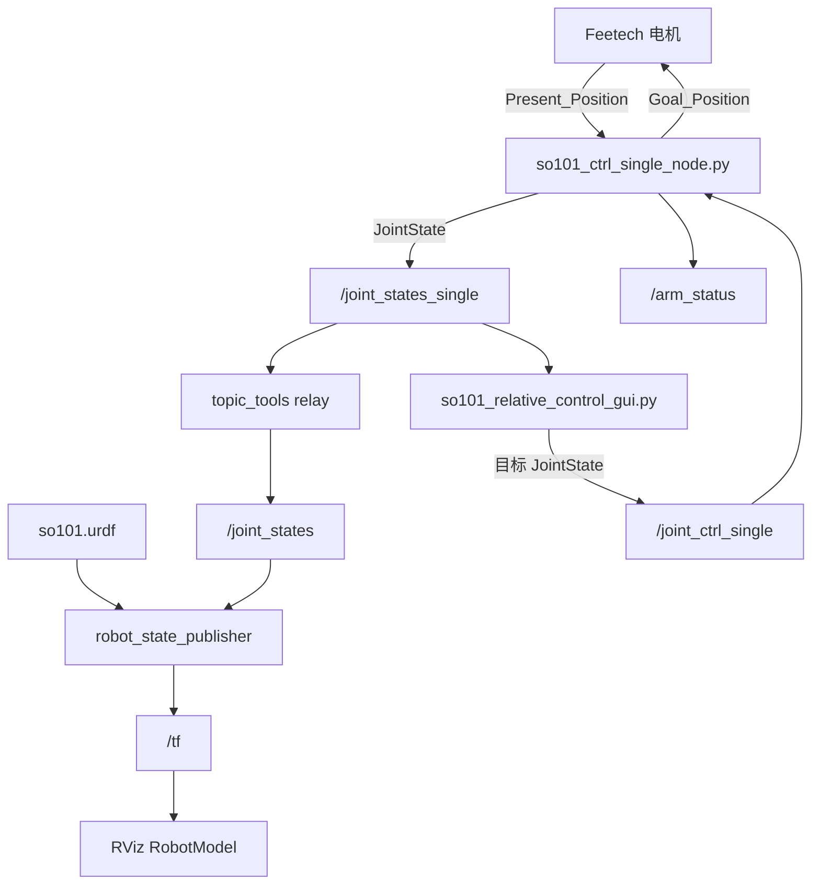

# SO101 ROS 项目源码带读

这份文档按程序真正运行的顺序带读源码：先看模型和启动入口，再跟进硬件节点怎样连接、读取、发布；然后追踪 GUI 如何接收反馈、产生目标，以及驱动节点怎样检查并写回电机。每一段代码都标出仓库文件和行号。行号对应当前版本，源码变化后可能移动。

## 0. 先看运行全图



这张图里，URDF 提供结构，`robot_state_publisher` 将关节角度转换为 TF；Python 驱动节点是唯一直接接触 LeRobot 电机总线的项目节点。GUI 只收发 ROS 数据，不直接操作电机。

## 0.1 先从宏观看：项目为什么拆成这些部分

把项目想成一个“翻译链”会比较容易理解：电机总线说的是设备位置，RViz 需要的是 ROS 关节状态和 TF，GUI 面对的是角度/百分比滑块。中间的 Python 驱动节点负责翻译设备数据和 ROS 消息；URDF 则提供“这些关节和 link 如何连接”的模型知识。

| 部分 | 它解决的问题 | 本项目中的实现 | 它不负责什么 |
|---|---|---|---|
| 机器人描述 | 机械臂有哪些刚体、关节怎么连接、模型外观是什么？ | `lwh_so101_description/urdf/so101.urdf`、`meshes/`、`rviz/so101.rviz` | 不读串口，不驱动电机 |
| 硬件桥 | 怎样把真实电机的读数/目标接入 ROS？ | `SO101CtrlSingleNode`，读取和写入 LeRobot bus | 不建模 link，也不画 UI |
| ROS 接口 | 不同节点如何交换关节状态、命令和状态？ | `JointState`、`SO101Status`、服务、topic | 接口本身不保证单位或语义正确，双方代码要遵守约定 |
| 可视化状态链 | 怎样把关节角变成 RViz 中的机器人姿态？ | relay、`robot_state_publisher`、RViz RobotModel | 不改变真实电机 |
| 操作界面 | 人怎样看反馈、输入关节目标和使能？ | PyQt GUI | 不直接连电机，也不做路径规划 |
| 组合启动 | 怎样给参数、加载模型并启动各节点？ | `start_so101_follower_rviz_control.launch` | 不实现上述模块内部算法 |

这里的关键是“职责分开、接口对接”：硬件桥知道电机总线但不需要知道 STL 网格；`robot_state_publisher` 知道 URDF 和 joint state，但不需要知道 Feetech 串口；GUI 知道滑块值，但不直接操作硬件。拆开后可以单独验证模型、驱动或 UI。

## 0.2 两条方向相反的数据流

### 反馈方向：硬件状态逐层变成画面

```text
电机当前值
  → 驱动读取 Present_Position
  → 将电机单位转换为 ROS JointState（弧度）
  → /joint_states_single
  → relay 到 /joint_states
  → robot_state_publisher 根据 URDF 计算 TF
  → RViz 按 TF 放置 link 的网格
```

这条方向回答“真实机械臂现在在哪里”。`/joint_states_single` 是项目驱动的原始 ROS 反馈出口；标准 `/joint_states` 是为了接上机器人状态发布器。GUI 也订阅 single 话题，自己转换成滑块显示单位。

### 控制方向：用户输入逐层变成电机目标

```text
滑块目标（角度/夹爪百分比）
  → GUI 转为 JointState（弧度）
  → /joint_ctrl_single
  → 驱动检查只读、扭矩、阻塞和消息内容
  → 转换回 LeRobot 的设备单位并限制目标变化
  → 写 Goal_Position
```

这条方向回答“用户希望机械臂去哪里”。它与反馈方向共用 `JointState` 类型，但不是同一类数据：一个是测量值，一个是设定值。区分方向要看 topic 和回调，不要只看消息类型。

### 状态/服务方向：改变驱动状态，而不是传关节数组

`/arm_status` 是驱动公布的状态快照；`/enable_srv` 是同步请求/响应接口，用于要求驱动改变扭矩状态；`/stop_srv` 等则改变是否接受后续命令。它们与关节反馈/目标 topic 是另一类接口，定义见 `msg/SO101Status.msg` 和 `srv/*.srv`，注册见驱动 `__init__()`。

## 0.3 按依赖顺序搭建，理解为什么这个顺序

完整项目并不是先写 GUI 再想办法接电机。每层都依赖前一层定义好的约定：

| 顺序 | 先做什么 | 为什么先做它 | 在当前仓库对应哪里 |
|---|---|---|---|
| 1 | 确认关节名、顺序、单位 | 这是模型、驱动和 UI 共同遵守的接口契约 | URDF joints、驱动和 GUI 的 `JOINT_NAMES` |
| 2 | 准备 URDF 和网格，单独看模型 | 先确认 link/joint 结构，不让硬件问题干扰模型问题 | `lwh_so101_description/urdf`、`meshes`、`rviz` |
| 3 | 只读连接总线并发布当前位置 | 先证明设备能被识别、读取和正确解释 | `_connect_bus()`、`_read_positions()`、`_publish_joint_state()` |
| 4 | 把状态送给 `robot_state_publisher` 和 RViz | 确认 ROS 关节名和 URDF 名对得上 | launch 的 relay 和 `robot_state_publisher` |
| 5 | 添加扭矩服务和目标写入门控 | 反馈正确后，才引入硬件写操作 | `_set_torque()`、`_send_joint_command()` |
| 6 | 添加 GUI，再由 launch 组合 | UI 成为 ROS 客户端，不重复实现硬件访问 | `so101_relative_control_gui.py`、launch |

仓库当前已经把这些阶段组合在一个 launch 中运行，但阅读时按这个依赖顺序拆开理解，会比从界面按钮开始更容易看清系统。

## 0.4 每层怎样单独验证

- **模型层**：查看 URDF 的根 link、joint 名和 mesh 路径；RViz 的 Fixed Frame 要能在 TF 树中找到。
- **硬件反馈层**：看 `/arm_status` 的 `connected/message`，再看 `/joint_states_single` 的六个名字、六个位置和刷新时间。
- **ROS 显示链**：比较 `/joint_states_single` 和 `/joint_states`，再看 `/tf` 是否随关节状态变化。
- **控制层**：确认 `read_only=false`、`torque_enabled=true`、`command_blocked=false`，再看命令是否到达驱动；否则驱动会按门控条件拒绝。
- **GUI 层**：确认界面收到反馈并同步滑块；再确认使能服务成功后才周期发布命令。

这种逐层验证也给出了排错方向：反馈话题都没有时，先查硬件桥；single 有、标准话题没有时，查 relay；关节话题有但模型不动时，查 joint 名/TF/RViz；状态正确但电机不执行时，查控制门控和总线写入。

## 1. 模型从哪里来：读 URDF

打开 [`so101.urdf`](/home/sdcdk/lwh_code/learn_soarm_ros/src/lwh_so101_description/urdf/so101.urdf:4)，先看根 link 和固定根关节（第 4–13 行）：

```xml
<robot name="so101">
  <link name="dummy_link"/>
  <joint name="dummy_to_base" type="fixed">
    <origin xyz="0 0 0" rpy="0 0 0"/>
    <parent link="dummy_link"/>
    <child link="base_link"/>
  </joint>
```

`dummy_link` 是 URDF 根，固定关节把实际底座 `base_link` 接在它下面。模型后续的关节沿 link 树连接。看腕部附近的关节例子（URDF 第 362–368 行）：

```xml
<joint name="wrist_roll" type="revolute">
  <origin xyz="5.55112e-17 -0.0611 0.0181" rpy="1.5708 0.0486795 3.14159"/>
  <parent link="wrist_link"/>
  <child link="gripper_link"/>
  <axis xyz="0 0 1"/>
  <limit effort="10" velocity="10" lower="-2.74385" upper="2.84121"/>
</joint>
```

这里具体给出了关节名、父子 link、相对位姿、旋转轴和限位。URDF 其余五个可动关节也使用相同结构；第 342–348 行定义 `gripper`，第 382–388 行定义 `wrist_flex`，第 403–409 行定义 `elbow_flex`，第 423–429 行定义 `shoulder_lift`，第 443–449 行定义 `shoulder_pan`。各 link 的 visual 引用 `package://lwh_so101_description/meshes/...` STL，例如 `base_link` 在第 30–42 行。

这里建立了一个重要约定：驱动和 GUI 必须使用 URDF 的 joint name。名称不匹配时，`robot_state_publisher` 无法把消息位置对应到模型关节。六个名称在驱动文件 [`so101_ctrl_single_node.py`](/home/sdcdk/lwh_code/learn_soarm_ros/src/lwh_so101_real/scripts/so101_ctrl_single_node.py:53) 第 53–60 行定义。

## 2. 谁把程序启动起来：读 launch 和 catkin 配置

入口是 [`start_so101_follower_rviz_control.launch`](/home/sdcdk/lwh_code/learn_soarm_ros/src/lwh_so101_real/launch/start_so101_follower_rviz_control.launch:1)。开头声明参数（第 2–12 行），例如串口、robot ID、标定目录、读写模式、断连策略和目标变化限制。URDF 在第 14 行加载到全局参数 `robot_description`：

```xml
<param name="robot_description"
       textfile="$(find lwh_so101_description)/urdf/so101.urdf"/>
```

之后启动的节点和连接关系在 launch 中明写（第 16–33 行）：

```xml
<node name="so101_ctrl_single_node" pkg="lwh_so101_real"
      type="so101_ctrl_single_node.py" output="screen">
  <param name="port" value="$(arg port)"/>
  <param name="read_only" value="$(arg read_only)"/>
</node>
<node name="robot_state_publisher" pkg="robot_state_publisher"
      type="robot_state_publisher"/>
<node name="joint_state_mux" pkg="topic_tools" type="relay"
      args="/joint_states_single /joint_states"/>
<node name="rviz" pkg="rviz" type="rviz"
      args="-d $(find lwh_so101_description)/rviz/so101.rviz"/>
<node name="so101_relative_control_gui" pkg="lwh_so101_real"
      type="so101_relative_control_gui.py"/>
```

上面的片段节选了驱动节点内的两个参数，其余参数见 launch 第 17–27 行。这里最值得追踪的是：launch 把 `robot_description` 给状态发布器；把驱动私有参数放到驱动节点下；再用 relay 对接驱动话题和 ROS 常用关节话题。

[`lwh_so101_real/CMakeLists.txt`](/home/sdcdk/lwh_code/learn_soarm_ros/src/lwh_so101_real/CMakeLists.txt) 中，`lwh_so101_real` 使用 `add_message_files`、`add_service_files` 和 `generate_messages` 生成自定义 ROS 类型；`install(PROGRAMS ...)` 安装两个 Python 节点。Description 包则通过 `install(DIRECTORY meshes rviz urdf ...)` 安装模型资源。

**参数的真实默认值要看 launch，而不能只看 Python。** 例如 launch 第 5 行的 `read_only=false` 会传给节点；Python 第 107 行的 `rospy.get_param("~read_only", True)` 中 `True` 只是参数缺失时的回退值。经 launch 启动时，实际值是 `false`。

## 3. 主节点入口：构造对象时做了什么

驱动脚本入口在 [`so101_ctrl_single_node.py`](/home/sdcdk/lwh_code/learn_soarm_ros/src/lwh_so101_real/scripts/so101_ctrl_single_node.py:492)：

```python
def main() -> None:
    rospy.init_node("so101_ctrl_single_node")
    node = SO101CtrlSingleNode()
    rospy.on_shutdown(node.shutdown)
    node.spin()
```

执行顺序是：初始化 rospy → 构造节点 → 注册退出清理 → 进入周期循环。构造函数 [`SO101CtrlSingleNode.__init__()`](/home/sdcdk/lwh_code/learn_soarm_ros/src/lwh_so101_real/scripts/so101_ctrl_single_node.py:101) 先读参数并建立状态（第 103–123 行）：

```python
self.port = rospy.get_param("~port", "/dev/ttyACM0")
self.robot_id = rospy.get_param("~robot_id", "my_awesome_follower_arm")
self.read_only = bool(rospy.get_param("~read_only", True))
self.auto_enable = bool(rospy.get_param("~auto_enable", False))
self.allow_disconnected = bool(rospy.get_param("~allow_disconnected", True))
self._connected = False
self._torque_enabled = False
self._command_blocked = bool(rospy.get_param("~start_blocked", False))
self._last_positions = None
```

紧接着它创建 ROS 接口（第 125–136 行）：

```python
self.joint_pub = rospy.Publisher("joint_states_single", JointState, queue_size=10)
self.status_pub = rospy.Publisher("arm_status", SO101Status, queue_size=10, latch=True)
rospy.Subscriber("joint_ctrl_single", JointState, self._joint_command_callback, queue_size=1)
rospy.Subscriber("enable_flag", Bool, self._enable_flag_callback, queue_size=1)
rospy.Service("enable_srv", Enable, self._enable_service)
```

同一段还注册了 `gripper_srv`、`go_zero_srv`、`stop_srv`、`reset_srv`、`block_arm`。发布器和订阅器名称没有 `/` 开头，所以是相对名称；launch 未设置命名空间时它们解析为根命名空间下的 `/joint_states_single` 等。

最后构造函数尝试连接硬件（第 138–143 行）。异常时若 `allow_disconnected=false` 就抛出并退出；默认 `true` 时进入 `_handle_connect_failure()`，使 ROS/RViz 仍能看到 fallback 关节状态。

## 4. 启动时如何连接机械臂

沿 [`_connect_bus()`](/home/sdcdk/lwh_code/learn_soarm_ros/src/lwh_so101_real/scripts/so101_ctrl_single_node.py:165) 读（第 165–195 行）：

```python
config_kwargs = {
    "port": self.port,
    "id": self.robot_id,
    "use_degrees": True,
    "disable_torque_on_disconnect": self.disable_torque_on_shutdown,
}
config_kwargs["calibration_dir"] = Path(self.calibration_dir).expanduser()
self._follower = SOFollower(SOFollowerRobotConfig(**config_kwargs))
self._bus = self._follower.bus
```

也就是说，节点用 LeRobot 配置对象建立 follower 并取出 bus。紧接着源码在第 178–184 行检查 `self.require_calibration and not self._bus.calibration`，缺少标定时抛出带预期文件路径的 `RuntimeError`；通过检查后第 185 行调用 `_connect_checked_bus()`，第 186 行才将 `_connected` 设为真。标定检查失败发生在电机握手之前。

`_connect_checked_bus()`（第 196–224 行）先尝试 `self._bus.connect(handshake=True)`。只有握手产生指定的 motor-check 错误且 `auto_port` 为真，才会扫描串口；扫描逻辑在 `_find_port_with_expected_motors()`（第 235–257 行），检查 `/dev/ttyACM*`、`/dev/ttyUSB*` 并寻找 ID 1–6。当前 launch 把 `auto_port` 设为 `false`（第 7 行），所以 launch 默认不会走扫描分支。

连接失败后的处理在 [`_handle_connect_failure()`](/home/sdcdk/lwh_code/learn_soarm_ros/src/lwh_so101_real/scripts/so101_ctrl_single_node.py:279)：关闭端口、清除 connected/torque 状态、把 `_last_positions` 设成 `FALLBACK_POSITIONS`，并保存错误文本。源码没有后台重连循环；构造阶段连接失败后，节点之后发布 fallback，但命令仍因 `_connected` 为 false 被拒绝。

## 5. 反馈链：从 `Present_Position` 到 RViz

### 5.1 驱动读取电机并发布 JointState

主循环在 [`spin()`](/home/sdcdk/lwh_code/learn_soarm_ros/src/lwh_so101_real/scripts/so101_ctrl_single_node.py:145)（第 145–151 行）：

```python
def spin(self):
    rate = rospy.Rate(self.publish_rate)
    while not rospy.is_shutdown():
        with self._lock:
            self._read_and_publish_once()
            self._publish_status()
        rate.sleep()
```

每轮持有同一把锁，避免读总线与 service/topic 回调同时操作总线。`_read_and_publish_once()`（第 264–277 行）检查连接状态：未连接则发布最后位置或 fallback；已连接则读位置、保存最近值并发布。实际总线读取在 `_read_positions()`（第 259–262 行）：

```python
def _read_positions(self):
    positions = self._bus.sync_read("Present_Position")
    return {name: float(positions[name]) for name in JOINT_NAMES}
```

再看 `_publish_joint_state()`（第 291–303 行），它把字典包装成标准消息：

```python
def _publish_joint_state(self, positions):
    msg = JointState()
    msg.header.stamp = rospy.Time.now()
    msg.name = list(JOINT_NAMES)
    msg.position = [
        deg_to_rad(positions["shoulder_pan"]),
        deg_to_rad(positions["shoulder_lift"]),
        deg_to_rad(positions["elbow_flex"]),
        deg_to_rad(positions["wrist_flex"]),
        deg_to_rad(positions["wrist_roll"]),
        gripper_percent_to_rad(positions["gripper"]),
    ]
    self.joint_pub.publish(msg)
```

这里是“硬件单位 → ROS/URDF 单位”的边界：五个关节调用 `deg_to_rad()`，夹爪调用百分比到弧度的映射。换句话说，`/joint_states_single.position` 的六项都是弧度。

### 5.2 驱动状态消息

[`SO101Status.msg`](/home/sdcdk/lwh_code/learn_soarm_ros/src/lwh_so101_real/msg/SO101Status.msg) 定义了 `connected`、`torque_enabled`、`read_only`、`command_blocked`、`port` 和 `message`。`_publish_status()`（驱动第 305–314 行）逐字段从节点状态赋值后发布。因为 publisher 的 `latch=True`，新订阅者也能收到最近一条状态。

### 5.3 从私有状态话题到 TF

launch 第 31 行配置 relay：

```xml
<node name="joint_state_mux" pkg="topic_tools" type="relay"
      args="/joint_states_single /joint_states"/>
```

所以状态链路为 `/joint_states_single` → `/joint_states`。launch 还启动 `robot_state_publisher`（第 30 行），并把 URDF 放在 `robot_description`。它使用 URDF 的 joint 名和 JointState 中的位置计算 TF；RViz 配置 [`so101.rviz`](/home/sdcdk/lwh_code/learn_soarm_ros/src/lwh_so101_description/rviz/so101.rviz:36) 打开 RobotModel，Fixed Frame 在第 50 行设为 `dummy_link`。这是模型显示链路，任何一段 topic、joint 名或 TF frame 不对都会让模型不更新。

## 6. 控制链：GUI 如何读取反馈并形成目标

GUI 构造函数 [`SO101ControlWindow.__init__()`](/home/sdcdk/lwh_code/learn_soarm_ros/src/lwh_so101_real/scripts/so101_relative_control_gui.py:75) 读取反馈/命令 topic，创建目标 publisher，并订阅反馈（GUI 第 78–98 行）：

```python
def __init__(self):
    self.feedback_topic = rospy.get_param("~feedback_topic", "/joint_states_single")
    self.command_topic = rospy.get_param("~command_topic", "/joint_ctrl_single")
    self.command_pub = rospy.Publisher(self.command_topic, JointState, queue_size=1)
    rospy.Subscriber(self.feedback_topic, JointState, self._feedback_callback, queue_size=1)
```

反馈回调 `_feedback_callback()`（第 308–315 行）把消息转成 UI 单位并存入 `_current`。转换函数 `_joint_state_to_values()`（第 317–329 行）先根据 `msg.name` 建索引，再检查六个名称齐全；五个角度从弧度转度，夹爪从弧度转百分比。

收到反馈后 `_refresh_current_labels()` 会在首次收到有效值时调用 `_sync_current()`（第 414–426 行）。`_sync_current()`（第 331–348 行）把当前姿态写进滑块，并通过 `_syncing` 标记避免同步滑块时被当作用户的新操作。

### 6.1 点使能按钮

按钮连接关系在 GUI `_build_ui()`（第 126–142 行）：使能按钮连接 `_enable()`，拖拽按钮连接 `_disable()`。`_enable()`（第 350–356 行）先同步当前姿态，再调用 `/enable_srv`；服务成功后设置 GUI 自身的 `_enabled=True` 并立即发布一次目标。服务调用具体在 `_call_enable()`（第 364–374 行）：等待服务存在，创建 `ServiceProxy`，发送 `Enable(enable_request=...)`。

服务类型的定义 [`Enable.srv`](/home/sdcdk/lwh_code/learn_soarm_ros/src/lwh_so101_real/srv/Enable.srv) 是：

```text
bool enable_request
---
bool enable_response
string message
```

“拖拽”按钮调用同一 service 发送 `false`。请注意：GUI 的 `_enabled` 是界面本地状态；驱动真实状态应从 `/arm_status` 查看。

### 6.2 滑块目标如何变成 JointState

GUI 创建 QTimer（第 299–306 行），周期调用 `_publish_target_if_enabled()`；GUI 默认频率 `publish_rate=20.0`。只有 `_enabled` 和 `_have_feedback` 同时为真才发布。`_publish_target()`（第 387–403 行）从 slider 读目标，填 `JointState.name` 和 `position`；关节角从度转弧度，夹爪从百分比转夹爪弧度，然后发布到 `/joint_ctrl_single`。

所以这里发出的消息不是传感器读数，而是“目标位置”。反馈 topic 和命令 topic 都使用 `JointState`，但语义由 topic 方向区分。

## 7. 命令链：驱动如何决定是否写电机

驱动订阅者将命令回调交给 `_send_joint_command()`（第 347–374 行）。关键的拒绝条件按源码顺序是：

```python
def _send_joint_command(self, msg):
    if self.read_only:
        return False, "read_only=true, ignoring joint command."
    if not self._torque_enabled:
        return False, "torque is disabled, ignoring joint command."
    if self._command_blocked:
        return False, "command_blocked=true, ignoring joint command."
    if self._bus is None:
        return False, "SO101 bus is not available."
```

通过前置检查后，它调用 `_extract_joint_targets()`，再调用 `_limit_relative_target()`，最后才执行：

```python
self._bus.sync_write("Goal_Position", safe_target)
```

`_extract_joint_targets()`（第 376–401 行）若消息有 name，按 name 找每个 position 并要求六个关节都出现；若没有 name，则要求至少六个 position 并按 `JOINT_NAMES` 顺序解释。随后 `_ros_position_to_lerobot()` 将五个关节弧度转成度，夹爪弧度转成百分比。

`_limit_relative_target()`（第 403–424 行）使用 `_last_positions` 作为当前值，将目标与反馈的差值 clamp 到 `±max_relative_target_deg`；夹爪单独按 `±max_relative_target_gripper` 限制。随后电机得到的是限制过的一次目标。这是目标差约束，不是速度规划。

## 8. 服务不是都走同一条路径

重点对照实现，不要仅从服务名推断行为：

| 服务 | 回调位置 | 代码实际做的事 |
|---|---|---|
| `enable_srv` | 驱动第 322–345 行 | `_set_torque()` 检查 connected 和 read_only，再调 `enable_torque()` / `disable_torque()` |
| `stop_srv` | 第 470–477 行 | 设置 `_command_blocked=True`，不关闭 torque |
| `reset_srv` | 第 479–483 行 | 设置 `_command_blocked=False` |
| `block_arm` | 第 485–489 行 | 直接根据 `SetBool.data` 设置阻塞状态 |
| `go_zero_srv` | 第 446–468 行 | 要求 confirm、可写、扭矩开启且未阻塞，再经相对限制写零目标 |
| `gripper_srv` | 第 426–444 行 | 检查只读/扭矩/阻塞后单独 `write("Goal_Position", "gripper", pct)` |

`stop_srv` 名字容易让人以为它是电机急停，但源码只挡后续关节命令；它不禁用扭矩，也不撤销已经发送的目标。`gripper_srv` 也没有走 `_limit_relative_target()`，它与 GUI 发送的完整 JointState 路径不同。

## 9. 把这条调用链从头复述一遍

沿代码讲解时，可以按下面顺序，每一步都能回到一个具体函数：

1. launch 把 URDF 放到 `robot_description`，启动驱动、状态发布器、relay、RViz 和 GUI。
2. 驱动 `main()` 构造 `SO101CtrlSingleNode`；构造函数读参数、注册 ROS 接口并调用 `_connect_bus()`。
3. 驱动的 `spin()` 循环调用 `sync_read("Present_Position")`，`_publish_joint_state()` 把角度转弧度并发布 `/joint_states_single`。
4. relay 转发到 `/joint_states`；`robot_state_publisher` 根据 URDF 计算 TF；RViz RobotModel 显示 link 网格。
5. GUI 订阅反馈、转换成滑块单位、首次同步当前姿态；使能按钮调用 `/enable_srv`。
6. GUI 定时将滑块转成 `JointState`，发布 `/joint_ctrl_single`。
7. 驱动回调检查 read-only、扭矩、阻塞、总线和消息字段，换回电机单位、限制相对目标，再写 `Goal_Position`。

## 10. 代码阅读练习与自检

建议真正打开文件，按这些断点单步读一遍：

| 顺序 | 源码位置 | 读完应能回答 |
|---|---|---|
| 1 | [`so101.urdf` 第 342–449 行](/home/sdcdk/lwh_code/learn_soarm_ros/src/lwh_so101_description/urdf/so101.urdf:342) | 六个 ROS 关节名怎样连接 link？夹爪的角度限位是什么？ |
| 2 | [`start_so101_follower_rviz_control.launch` 第 14–33 行](/home/sdcdk/lwh_code/learn_soarm_ros/src/lwh_so101_real/launch/start_so101_follower_rviz_control.launch:14) | 哪个节点发布关节反馈？为什么有 relay？ |
| 3 | [`SO101CtrlSingleNode.__init__()`](/home/sdcdk/lwh_code/learn_soarm_ros/src/lwh_so101_real/scripts/so101_ctrl_single_node.py:101) | 哪些变量控制能否写电机？服务和 topic 在哪里注册？ |
| 4 | [`_connect_bus()`、`_connect_checked_bus()`](/home/sdcdk/lwh_code/learn_soarm_ros/src/lwh_so101_real/scripts/so101_ctrl_single_node.py:165) | 标定检查、握手、自动找串口分别在什么条件执行？ |
| 5 | [`_read_positions()` 到 `_publish_joint_state()`](/home/sdcdk/lwh_code/learn_soarm_ros/src/lwh_so101_real/scripts/so101_ctrl_single_node.py:259) | 单位转换在哪里发生？消息 name 和 position 怎样对应？ |
| 6 | [GUI 反馈与目标代码](/home/sdcdk/lwh_code/learn_soarm_ros/src/lwh_so101_real/scripts/so101_relative_control_gui.py:308) | UI 怎样从反馈设 slider，又怎样发目标？ |
| 7 | [`_send_joint_command()` 到 `_limit_relative_target()`](/home/sdcdk/lwh_code/learn_soarm_ros/src/lwh_so101_real/scripts/so101_ctrl_single_node.py:347) | 哪些检查会提前拒绝命令？实际限制了什么？ |
| 8 | [`_set_torque()` 和服务回调](/home/sdcdk/lwh_code/learn_soarm_ros/src/lwh_so101_real/scripts/so101_ctrl_single_node.py:322) | stop 与 disable torque 是不是同一件事？ |

练习：设想把第一个关节改名为 `base_yaw`，逐个找出 URDF、驱动 `JOINT_NAMES`、GUI `JOINT_NAMES`、关节限位字典中要同步更新的位置。再设想把夹爪设备单位改为弧度，找出反馈和命令两条方向上的转换函数。能找到这些点，就说明理解了项目的接口契约和数据转换边界。

## 11. 从源码发现的实现边界

以下结论都来自当前代码，而非对系统能力的猜测：

- launch 将 `read_only` 设为 `false`，而驱动代码缺省值是 `true`；通过当前 launch 启动时以前者为准。launch 的 `auto_port=false` 也覆盖代码缺省 `true`。
- launch 的标定路径默认固定为 `/home/a/.cache/...`；驱动代码的回退路径则基于 `Path.home()`。迁移主机时前者需要核对。
- 驱动脚本 shebang 和 `ROS_PYTHON_PATHS` 含 `/home/a/...` 路径，并显式要求 Python 3.10+（脚本第 1–39 行）。catkin 能生成消息不代表该 LeRobot Python 环境一定可用。
- GUI 只调用 `enable_srv`，未订阅 `/arm_status`。GUI 的模式标记不等价于驱动状态消息。
- `allow_disconnected=true` 会保留 ROS 节点并发布 fallback，但构造阶段失败后没有重连逻辑。
- GUI slider 有绝对范围；驱动通用 JointState 路径只实现相对目标限制，没有对五个身体关节再套 URDF 的绝对 joint limit。
- URDF 有 transmission 描述，但 launch 没有启动 ros_control controller；项目的真实读写实现是 Python 节点直接调用 LeRobot bus。

## 12. 用 ROS 观测点验证自己的理解

按源码的数据方向逐点观察：

```bash
rostopic echo -n1 /arm_status
rostopic echo -n1 /joint_states_single
rostopic echo -n1 /joint_states
rostopic echo -n1 /tf
```

预期关系是：`/joint_states_single` 有六个名称和六个弧度位置；`/joint_states` 是 relay 后的同类状态；`/tf` 中能看到以 `dummy_link` 为根的 link 变换。若第一项没有有效反馈，先看 `/arm_status` 的 `connected` 和 `message`；若 single 正常但标准 topic 没数据，检查 launch relay；若 joint states 正常但模型不动，检查 URDF 名称和 TF/RViz frame。

---

## 13. 把核心实现放在一起读：每个目标先想设计，再看代码

前面的章节先搭好概念地图，这一部分把关键代码集中呈现。代码来自当前仓库，注释是为了教学补充的解释；不改变代码逻辑。为了让主链路清楚，省略了 imports、窗口 CSS 和纯排版代码，但节点的状态、ROS 接口、关键回调和单位转换都在下面。

### 13.1 目标：让机械臂模型拥有稳定、可更新的关节结构

**先想实现思路。** RViz 需要一棵从根 link 开始的 TF 树。每个刚体要成为一个 `link`，相邻刚体之间要有 `joint` 描述连接方式。关节名字是驱动状态和模型之间的键；机械关节的 position 按弧度解释。外观 mesh 只是 link 的 visual，不负责运动学。

以下摘录自 [`so101.urdf`](</home/sdcdk/lwh_code/learn_soarm_ros/src/lwh_so101_description/urdf/so101.urdf:4>)，展示根、肩、腕、夹爪的结构和关节映射：

```xml
<robot name="so101">
  <!-- 空根 link：作为整棵机器人 TF 树和 RViz Fixed Frame 的起点。 -->
  <link name="dummy_link"/>

  <!-- fixed joint 不提供自由度，只把模型底座挂到根坐标系上。 -->
  <joint name="dummy_to_base" type="fixed">
    <origin xyz="0 0 0" rpy="0 0 0"/>
    <parent link="dummy_link"/>
    <child link="base_link"/>
  </joint>

  <!-- ... 中间是各 link 的 visual/collision/inertial 定义 ... -->

  <!-- 基座到肩部：驱动发布同名 shoulder_pan 的 position。 -->
  <joint name="shoulder_pan" type="revolute">
    <origin xyz="0.0388353 -8.97657e-09 0.0624"
            rpy="3.14159 4.18253e-17 -3.14159"/>
    <parent link="base_link"/>
    <child link="shoulder_link"/>
    <axis xyz="0 0 1"/>
    <limit effort="10" velocity="10" lower="-1.91986" upper="1.91986"/>
  </joint>

  <!-- 肩 lift、肘 flex、腕 flex 采用相同的 joint 结构，各自连接相邻 link。 -->

  <!-- 腕 roll：改变 gripper_link 相对 wrist_link 的旋转。 -->
  <joint name="wrist_roll" type="revolute">
    <origin xyz="5.55112e-17 -0.0611 0.0181"
            rpy="1.5708 0.0486795 3.14159"/>
    <parent link="wrist_link"/>
    <child link="gripper_link"/>
    <axis xyz="0 0 1"/>
    <limit effort="10" velocity="10" lower="-2.74385" upper="2.84121"/>
  </joint>

  <!-- 夹爪有独立的旋转范围，和驱动中百分比↔弧度的映射对应。 -->
  <joint name="gripper" type="revolute">
    <origin xyz="0.0202 0.0188 -0.0234"
            rpy="1.5708 -5.24284e-08 -1.41553e-15"/>
    <parent link="gripper_link"/>
    <child link="moving_jaw_so101_v1_link"/>
    <axis xyz="0 0 1"/>
    <limit effort="10" velocity="10" lower="-0.174533" upper="1.74533"/>
  </joint>
</robot>
```

上面明确标了省略内容：仓库实际 URDF 中还完整定义 `shoulder_lift`、`elbow_flex`、`wrist_flex` 和各 link 的网格；它们的关节名与驱动的六项列表一一对应。看这段时重点不是背数值，而是理解：`parent → joint → child` 构成树；`origin` 放置关节；`axis` 定义转轴；`limit` 描述 URDF 侧的角度范围。驱动反馈消息中的名称/位置由此树驱动 TF。

### 13.2 目标：启动时把模型、硬件桥、TF、RViz 和 GUI 接成一套

**先想实现思路。** 每个节点单独启动都需要正确参数和话题；launch 的职责是把依赖准备好并启动节点，不实现硬件算法。URDF 放入参数服务器；驱动拿私有参数；relay 解决驱动话题名和下游标准话题名之间的差异。

这是仓库的完整 [`start_so101_follower_rviz_control.launch`](</home/sdcdk/lwh_code/learn_soarm_ros/src/lwh_so101_real/launch/start_so101_follower_rviz_control.launch:1>)，逐项添加注释：

```xml
<launch>
  <!-- 传给驱动的可覆盖配置。arg 是 roslaunch 参数，不是 ROS topic。 -->
  <arg name="port" default="/dev/ttyACM0"/>
  <arg name="robot_id" default="my_awesome_follower_arm"/>
  <arg name="calibration_dir" default="/home/a/.cache/huggingface/lerobot/calibration/robots/so101_follower"/>
  <arg name="read_only" default="false"/>
  <arg name="auto_enable" default="false"/>
  <arg name="auto_port" default="false"/>
  <arg name="allow_disconnected" default="true"/>
  <arg name="publish_rate" default="50.0"/>
  <arg name="max_relative_target_deg" default="10.0"/>
  <arg name="max_relative_target_gripper" default="15.0"/>
  <arg name="disable_torque_on_shutdown" default="false"/>

  <!-- 加载机器人模型；robot_state_publisher 从此参数读取 URDF。 -->
  <param name="robot_description"
         textfile="$(find lwh_so101_description)/urdf/so101.urdf"/>

  <!-- 硬件桥：每个 param 在节点私有命名空间下，对应 rospy 的 ~参数。 -->
  <node name="so101_ctrl_single_node" pkg="lwh_so101_real"
        type="so101_ctrl_single_node.py" output="screen">
    <param name="port" value="$(arg port)"/>
    <param name="robot_id" value="$(arg robot_id)"/>
    <param name="calibration_dir" value="$(arg calibration_dir)"/>
    <param name="read_only" value="$(arg read_only)"/>
    <param name="auto_enable" value="$(arg auto_enable)"/>
    <param name="auto_port" value="$(arg auto_port)"/>
    <param name="allow_disconnected" value="$(arg allow_disconnected)"/>
    <param name="publish_rate" value="$(arg publish_rate)"/>
    <param name="max_relative_target_deg" value="$(arg max_relative_target_deg)"/>
    <param name="max_relative_target_gripper" value="$(arg max_relative_target_gripper)"/>
    <param name="disable_torque_on_shutdown" value="$(arg disable_torque_on_shutdown)"/>
  </node>

  <!-- 订阅 /joint_states，结合 robot_description 发布 link 间 TF。 -->
  <node name="robot_state_publisher" pkg="robot_state_publisher"
        type="robot_state_publisher" output="screen"/>

  <!-- 只转发消息，不换单位、不修改内容。 -->
  <node name="joint_state_mux" pkg="topic_tools" type="relay"
        args="/joint_states_single /joint_states" output="screen"/>

  <!-- RViz 读取模型配置；GUI 是发布目标、订阅反馈的 ROS 客户端。 -->
  <node name="rviz" pkg="rviz" type="rviz"
        args="-d $(find lwh_so101_description)/rviz/so101.rviz" output="screen"/>
  <node name="so101_relative_control_gui" pkg="lwh_so101_real"
        type="so101_relative_control_gui.py" output="screen"/>
</launch>
```

要理解默认值优先级：launch 传入的值覆盖 `rospy.get_param()` 的代码回退值。所以这里运行时 `read_only=false`、`auto_port=false`，即使 Python 回退值分别是 `True` 和 `True`。这也说明启动文件是系统集成的一部分，而不只是一个快捷命令。

### 13.3 目标：让 ROS 类型和接口能够被节点使用

**先想实现思路。** 标准的关节状态已经有 `sensor_msgs/JointState`，不需要为关节数组另造消息。项目只为自己关心的驱动状态定义 `SO101Status`，再用服务描述“发请求后立即返回结果”的动作，例如开/关 torque。

`SO101Status.msg` 的全部定义如下：

```text
# 标准 ROS Header：记录状态生成时间等元数据。
std_msgs/Header header
# 连接握手是否成功。
bool connected
# 驱动记录的 torque 状态。
bool torque_enabled
# 当前是否通过 read_only 门控拒绝写操作。
bool read_only
# 是否拒绝后续目标。
bool command_blocked
# 当前实际使用的串口。
string port
# 最近一次状态/错误的文字说明。
string message
```

`Enable.srv` 是 GUI 使能按钮使用的服务：

```text
# 请求：true 表示要求使能 torque，false 表示要求关闭 torque。
bool enable_request
---
# 响应：是否执行成功，以及节点给出的解释。
bool enable_response
string message
```

另外两个服务定义分别是：

```text
# GoZero.srv：调用方必须明确确认要发回零目标。
bool confirm
---
bool status
string message

# Gripper.srv：夹爪以设备侧百分比表示，范围在驱动回调中夹到 0..100。
float64 gripper_position
---
bool status
string message
```

定义文件需要 catkin 生成 Python 消息类。对应 [`CMakeLists.txt`](</home/sdcdk/lwh_code/learn_soarm_ros/src/lwh_so101_real/CMakeLists.txt:1>) 的关键部分：

```cmake
find_package(catkin REQUIRED COMPONENTS
  message_generation rospy sensor_msgs std_msgs std_srvs
)

# 告诉 catkin 从 msg/ 目录生成 SO101Status 类型。
add_message_files(FILES SO101Status.msg)

# 三个 srv 文件分别生成 Enable、Gripper、GoZero 的服务类型。
add_service_files(FILES Enable.srv Gripper.srv GoZero.srv)

# 自定义消息内使用了 std_msgs/Header，因此声明消息依赖。
generate_messages(DEPENDENCIES std_msgs)

# 让依赖本包的 catkin 包可以使用运行时消息类型。
catkin_package(CATKIN_DEPENDS message_runtime rospy sensor_msgs std_msgs std_srvs)
```

因此 Python 中的 `from lwh_so101_real.msg import SO101Status` 不是直接读 `.msg` 文件，而是导入 catkin 构建时生成的 Python 代码。

### 13.4 目标：启动驱动并把状态分成“连接、反馈、命令”三类

**先想实现思路。** 一个 ROS 硬件节点启动后要做四件事：读取配置；保存自己的状态；创建消息接口；尝试连接硬件。运行时再进入周期循环。状态字段要分清：`connected` 表示总线是否连通，`torque_enabled` 表示节点是否执行了使能，`command_blocked` 表示是否拒绝命令；这三个含义不能互相代替。

下面是驱动节点的精简生命周期骨架，来自 [`SO101CtrlSingleNode.__init__()`、`spin()` 和 `main()`](</home/sdcdk/lwh_code/learn_soarm_ros/src/lwh_so101_real/scripts/so101_ctrl_single_node.py:101>)：

```python
class SO101CtrlSingleNode:
    def __init__(self):
        # 私有 ROS 参数：launch 中节点内部的 <param> 会传入这里。
        self.port = rospy.get_param("~port", "/dev/ttyACM0")
        self.robot_id = rospy.get_param("~robot_id", "my_awesome_follower_arm")
        self.calibration_dir = rospy.get_param("~calibration_dir", str(DEFAULT_CALIBRATION_DIR))
        self.publish_rate = float(rospy.get_param("~publish_rate", 50.0))
        self.read_only = bool(rospy.get_param("~read_only", True))
        self.auto_enable = bool(rospy.get_param("~auto_enable", False))
        self.auto_port = bool(rospy.get_param("~auto_port", True))
        self.allow_disconnected = bool(rospy.get_param("~allow_disconnected", True))
        self.require_calibration = bool(rospy.get_param("~require_calibration", True))
        self.disable_torque_on_shutdown = bool(
            rospy.get_param("~disable_torque_on_shutdown", False)
        )
        self.max_relative_target_deg = float(
            rospy.get_param("~max_relative_target_deg", 10.0)
        )
        self.max_relative_target_gripper = float(
            rospy.get_param("~max_relative_target_gripper", 15.0)
        )

        # 同一串口总线会被循环读取，也会被 ROS 回调写入。
        # RLock 让这些操作串行，避免同时操作 bus。
        self._lock = threading.RLock()
        self._follower = None
        self._bus = None

        # 三个不同状态：连接、torque、命令阻塞。
        self._connected = False
        self._torque_enabled = False
        self._command_blocked = bool(rospy.get_param("~start_blocked", False))
        self._last_status = "starting"
        self._last_positions = None  # 最近一次成功读取的设备单位位置

        # feedback/status 两个 publisher。
        self.joint_pub = rospy.Publisher("joint_states_single", JointState, queue_size=10)
        self.status_pub = rospy.Publisher("arm_status", SO101Status, queue_size=10, latch=True)

        # 订阅 GUI 命令和另一种 Bool 扭矩控制入口。
        rospy.Subscriber("joint_ctrl_single", JointState,
                         self._joint_command_callback, queue_size=1)
        rospy.Subscriber("enable_flag", Bool,
                         self._enable_flag_callback, queue_size=1)

        # 服务用于请求-响应型操作；每个服务都绑定到对应回调。
        rospy.Service("enable_srv", Enable, self._enable_service)
        rospy.Service("gripper_srv", Gripper, self._gripper_service)
        rospy.Service("go_zero_srv", GoZero, self._go_zero_service)
        rospy.Service("stop_srv", Trigger, self._stop_service)
        rospy.Service("reset_srv", Trigger, self._reset_service)
        rospy.Service("block_arm", SetBool, self._block_service)

        # 连接失败时可选择保留 ROS 节点，让模型仍可显示 fallback 状态。
        try:
            self._connect_bus()
        except Exception as exc:
            if not self.allow_disconnected:
                raise
            self._handle_connect_failure(exc)

    def spin(self):
        # 50 Hz 是 launch 当前配置；每轮读取反馈并发布状态。
        rate = rospy.Rate(self.publish_rate)
        while not rospy.is_shutdown():
            with self._lock:
                self._read_and_publish_once()
                self._publish_status()
            rate.sleep()

    def shutdown(self):
        # ROS 退出时释放总线；是否关闭 torque 由参数决定。
        with self._lock:
            if self._bus is None or not self._connected:
                return
            try:
                self._bus.disconnect(
                    disable_torque=self.disable_torque_on_shutdown
                )
            except Exception as exc:
                # 关闭失败只记日志，finally 仍更新节点本地状态。
                rospy.logwarn("Failed to disconnect SO101 bus cleanly: %s", exc)
            finally:
                self._connected = False
                self._torque_enabled = False


def main():
    rospy.init_node("so101_ctrl_single_node")
    node = SO101CtrlSingleNode()
    rospy.on_shutdown(node.shutdown)
    node.spin()
```

源码中 shutdown 还有异常日志处理，`main()` 还有类型标注以及 `if __name__ == "__main__"` 入口保护；这里折叠了非核心行。你可以把这段想成节点生命周期：构造阶段注册接口和连接，运行阶段循环读写状态，退出阶段清理连接。

### 13.5 目标：建立总线连接时既加载标定，又确认电机确实在线

**先想实现思路。** “串口设备存在”不等于“机械臂电机在线”：USB 转串口可能打开成功，但电机供电/总线仍不可用。因此连接分为配置构造、标定检查、握手三个阶段。自动扫描只有显式打开时才执行。

源码核心逻辑（来自 `_connect_bus()` 和 `_connect_checked_bus()`）：

```python
def _connect_bus(self):
    # use_degrees=True 是设备侧单位约定之一：身体关节以度读写。
    config_kwargs = {
        "port": self.port,
        "id": self.robot_id,
        "use_degrees": True,
        "disable_torque_on_disconnect": self.disable_torque_on_shutdown,
    }
    calibration_dir = Path(self.calibration_dir).expanduser()
    config_kwargs["calibration_dir"] = calibration_dir

    self._follower = SOFollower(SOFollowerRobotConfig(**config_kwargs))
    self._bus = self._follower.bus

    # 标定缺失时在握手前失败，避免用未标定的映射解释关节位置。
    if self.require_calibration and not self._bus.calibration:
        raise RuntimeError(
            "No SO101 calibration file was loaded. Run lerobot-calibrate first, "
            f"or pass robot_id/calibration_dir that points to an existing calibration. "
            f"Current expected file: {calibration_dir / (str(self.robot_id) + '.json')}"
        )

    self._connect_checked_bus()
    self._connected = True
    self._last_status = "connected read-only" if self.read_only else "connected"

    # auto_enable 还受 read_only 控制；只读模式不能主动开 torque。
    if self.auto_enable:
        if self.read_only:
            rospy.logwarn("auto_enable requested but read_only=true, leaving torque disabled.")
        else:
            self._set_torque(True)


def _connect_checked_bus(self):
    # 首选用户指定端口并握手检查电机。
    try:
        self._bus.connect(handshake=True)
        return
    except RuntimeError as exc:
        # 只有电机检查失败且 auto_port 打开，才进入扫描逻辑。
        if not self.auto_port or "motor check failed" not in str(exc):
            raise
        self._close_bus_port()

    # 扫描 ACM/USB 设备，要求 motor ID 1 到 6 都出现。
    selected_port = self._find_port_with_expected_motors()
    if selected_port is None:
        raise RuntimeError(
            "SO101 motor bus was not found. The requested port opened, but no expected motors "
            f"{sorted(EXPECTED_MOTOR_IDS)} responded.\n"
            "Check these in order:\n"
            "  1. Use the Feetech motor-controller USB port, not another ACM/USB device.\n"
            "  2. Make sure the arm motor power is on; USB alone may enumerate a port but motors stay silent.\n"
            "  3. Check the servo bus cable and adapter orientation.\n"
            "  4. If motors were reconfigured, run LeRobot motor setup/calibration so IDs 1-6 and baudrate match."
        )

    # 用发现的端口重建 follower/bus，然后重新 handshake。
    self.port = selected_port
    self._follower.config.port = selected_port
    self._follower = SOFollower(self._follower.config)
    self._bus = self._follower.bus
    self._bus.connect(handshake=True)


def _find_port_with_expected_motors(self):
    # 只搜索两类常见串口节点，并去重、排序以保持扫描次序稳定。
    ports = []
    for pattern in SERIAL_PORT_PATTERNS:
        ports.extend(glob(pattern))
    ports = sorted(set(ports))
    if not ports:
        rospy.logwarn("No serial ports found under %s.", ", ".join(SERIAL_PORT_PATTERNS))
        return None

    for port in ports:
        try:
            # scan_port 返回不同 baud 下找到的 motor IDs。
            found_by_baud = self._bus.__class__.scan_port(port)
        except Exception as exc:
            rospy.logwarn("SO101 scan skipped %s: %s", port, exc)
            continue

        found_ids = set()
        for ids in found_by_baud.values():
            found_ids.update(int(id_) for id_ in ids)
        # 必须找到全部 1..6，单个 ACM 设备存在还不够。
        if EXPECTED_MOTOR_IDS.issubset(found_ids):
            return port
    return None
```

连接失败时实际异常还会列出 USB 口、电机供电、总线线缆和电机 ID 检查建议。**重要：当前 launch 的 `auto_port=false`，所以默认不会自动扫描；而且代码只在启动构造时连接，没有周期性重连。**

### 13.6 目标：把设备反馈转换成所有 ROS 消费者都懂的消息

**先想实现思路。** 硬件库返回按关节名组织的数据，ROS 使用 `JointState` 的 `name[]` 与 `position[]` 两个平行数组。要确保相同索引表示同一关节，并且统一 ROS/URDF 所需的弧度单位。夹爪是例外，因为 LeRobot 侧用百分比，所以需要线性映射到 URDF 的夹爪角度。

以下是反馈主链的完整关键函数：

```python
def _read_positions(self):
    # 从 LeRobot bus 同步读取所有电机的 Present_Position。
    positions = self._bus.sync_read("Present_Position")
    # 统一成 {joint_name: float}；若某个名称缺失，这里会抛出异常。
    return {name: float(positions[name]) for name in JOINT_NAMES}


def _read_and_publish_once(self):
    if not self._connected:
        # 启动连接失败时发 fallback，让 ROS/RViz 图形链仍能保持运行。
        self._publish_joint_state(self._last_positions or FALLBACK_POSITIONS)
        return

    try:
        positions = self._read_positions()
        self._last_positions = positions  # 保存设备单位值，供目标步长限制使用。
        self._publish_joint_state(positions)
        if self._last_status.startswith("read failed"):
            self._last_status = "connected"
    except Exception as exc:
        # 读取失败不发布坏数据；下一轮继续重试，并保留之前的最后姿态。
        self._last_status = f"read failed: {exc}"
        rospy.logwarn_throttle(2.0, "SO101 read failed: %s", exc)


def _publish_joint_state(self, positions):
    msg = JointState()
    msg.header.stamp = rospy.Time.now()  # 当前采样/发布时刻
    msg.name = list(JOINT_NAMES)         # 与 position 同索引一一对应
    msg.position = [
        deg_to_rad(positions["shoulder_pan"]),
        deg_to_rad(positions["shoulder_lift"]),
        deg_to_rad(positions["elbow_flex"]),
        deg_to_rad(positions["wrist_flex"]),
        deg_to_rad(positions["wrist_roll"]),
        gripper_percent_to_rad(positions["gripper"]),
    ]
    self.joint_pub.publish(msg)  # /joint_states_single


def _publish_status(self):
    # 这是诊断状态，不是关节位置；latch=True 会保留最后一条消息。
    msg = SO101Status()
    msg.header.stamp = rospy.Time.now()
    msg.connected = self._connected
    msg.torque_enabled = self._torque_enabled
    msg.read_only = self.read_only
    msg.command_blocked = self._command_blocked
    msg.port = self.port
    msg.message = self._last_status
    self.status_pub.publish(msg)


def deg_to_rad(value):
    # ROS JointState / URDF 使用弧度。
    return value * math.pi / 180.0


def rad_to_deg(value):
    # LeRobot 关节目标使用度。
    return value * 180.0 / math.pi


def gripper_percent_to_rad(value):
    # 防止设备百分比超出 0..100 后映射到 URDF 关节范围之外。
    pct = clamp(value, 0.0, 100.0)
    # 线性映射：0% -> -0.174533 rad，100% -> 1.74533 rad。
    return GRIPPER_RAD_MIN + (GRIPPER_RAD_MAX - GRIPPER_RAD_MIN) * pct / 100.0


def gripper_rad_to_percent(value):
    # 反向映射，同时限制输入在 URDF 的夹爪角度区间。
    rad = clamp(value, GRIPPER_RAD_MIN, GRIPPER_RAD_MAX)
    return (rad - GRIPPER_RAD_MIN) * 100.0 / (GRIPPER_RAD_MAX - GRIPPER_RAD_MIN)
```

例如驱动读到 `shoulder_pan=30`（度），消息里会写 `30 × π/180 ≈ 0.5236`（弧度）。夹爪若读到 50%，消息角度是上下限的中点。relay 原样转发该消息；`robot_state_publisher` 根据同名 URDF joint 计算 TF。节点的状态消息另由 `_publish_status()` 发送：字段来自 `_connected`、`_torque_enabled`、`read_only`、`_command_blocked`、`port` 和 `_last_status`。

### 13.7 目标：把 GUI 当前反馈显示成可操作的滑块

**先想实现思路。** UI 中人更适合看角度和百分比，不适合看弧度；滑块初始值必须从真实反馈同步，避免窗口一打开就把“默认零位”误当成新的目标。订阅回调只缓存最新反馈，Qt 定时器负责刷新界面，二者通过锁保护共享字典。

下面是 GUI 数据契约和反馈路径的代码（`_build_ui()` 里的样式表省略）：

```python
JOINT_NAMES = [
    "shoulder_pan", "shoulder_lift", "elbow_flex",
    "wrist_flex", "wrist_roll", "gripper",
]
JOINT_LIMITS = {
    "shoulder_pan": (-110.0, 110.0, "deg"),
    "shoulder_lift": (-100.0, 100.0, "deg"),
    "elbow_flex": (-96.8, 96.8, "deg"),
    "wrist_flex": (-95.0, 95.0, "deg"),
    "wrist_roll": (-157.2, 162.8, "deg"),
    "gripper": (0.0, 100.0, "%"),
}
SCALE = 10  # QSlider 必须用整数，所以 0.1 度/百分比对应 1 个 slider 单位。


class SO101ControlWindow(QMainWindow):
    def __init__(self):
        super().__init__()
        self.feedback_topic = rospy.get_param("~feedback_topic", "/joint_states_single")
        self.command_topic = rospy.get_param("~command_topic", "/joint_ctrl_single")
        self.publish_rate = float(rospy.get_param("~publish_rate", 20.0))

        # ROS Subscriber 回调与 Qt 主线程都会访问当前值，因此加锁。
        self._lock = threading.RLock()
        self._current = {}
        self._have_feedback = False
        self._enabled = False       # GUI 本地状态，成功调用服务后才置 True。
        self._syncing = False       # 区分程序同步滑块和用户拖动。
        self._initial_synced = False

        self.command_pub = rospy.Publisher(self.command_topic, JointState, queue_size=1)
        self.sliders = {}
        self.value_labels = {}
        self.current_labels = {}
        self.status_label = QLabel("等待真实机械臂反馈")
        self._build_ui()             # 创建按钮、六个 slider 和数值标签。
        self._setup_timers()         # 定时刷新当前值、周期发送目标。
        rospy.Subscriber(self.feedback_topic, JointState,
                         self._feedback_callback, queue_size=1)

    def _build_ui(self):
        # 以下摘自实际 _build_ui()，只省略布局容器和 CSS 样式。
        self.enable_button = QPushButton("使能")
        self.disable_button = QPushButton("拖拽")
        self.sync_button = QPushButton("同步当前位置")
        self.enable_button.clicked.connect(self._enable)
        self.disable_button.clicked.connect(self._disable)
        self.sync_button.clicked.connect(self._sync_current)

        for row, name in enumerate(JOINT_NAMES, start=1):
            lower, upper, unit = JOINT_LIMITS[name]
            slider = QSlider(Qt.Horizontal)
            # QSlider 是整数，因此将可显示范围扩大 SCALE 倍。
            slider.setMinimum(round(lower * SCALE))
            slider.setMaximum(round(upper * SCALE))
            slider.setSingleStep(1)
            slider.setPageStep(10)
            slider.valueChanged.connect(self._on_slider_moved)

            value_label = QLabel("--")
            current_label = QLabel("--")
            # 保存 widget 引用，反馈同步和目标读取都通过关节名找到它。
            self.sliders[name] = slider
            self.value_labels[name] = (value_label, unit)
            self.current_labels[name] = (current_label, unit)

    def _joint_state_to_values(self, msg):
        # JointState 要求 name 和 position 对齐；空 name 无法安全识别关节。
        if not msg.name or len(msg.position) < len(msg.name):
            return {}
        by_name = {name: msg.position[idx] for idx, name in enumerate(msg.name)}
        # 缺一个关节就拒绝整包，防止 slider 混合新旧姿态。
        if any(name not in by_name for name in JOINT_NAMES):
            return {}

        values = {}
        # 反馈消息是弧度，身体关节 UI 显示成度。
        for name in JOINT_NAMES[:-1]:
            values[name] = rad_to_deg(float(by_name[name]))
        # 夹爪 feedback 弧度转换成百分比显示。
        values["gripper"] = gripper_rad_to_percent(float(by_name["gripper"]))
        return values

    def _feedback_callback(self, msg):
        values = self._joint_state_to_values(msg)
        if not values:
            return
        with self._lock:
            self._current = values       # 覆盖成最新状态，不排队显示旧状态。
            self._have_feedback = True

    def _sync_current(self):
        with self._lock:
            if not self._current:
                self._set_status("还没有收到真实机械臂反馈")
                return
            current = dict(self._current)  # 锁内复制，之后可安全更新 UI。

        self._syncing = True
        try:
            for name, value in current.items():
                lower, upper, _unit = JOINT_LIMITS[name]
                # GUI 位置限制后乘 SCALE，转成整数 slider 刻度。
                self.sliders[name].setValue(
                    round(clamp(value, lower, upper) * SCALE)
                )
        finally:
            self._syncing = False
        self._refresh_target_labels()
        self._refresh_current_labels()
        self._set_status("已同步到当前位置")

    def _refresh_current_labels(self):
        with self._lock:
            current = dict(self._current)
        if not current:
            return
        if not self._initial_synced:
            # 首次有反馈时，将目标滑块设置成当前姿态。
            self._initial_synced = True
            self._sync_current()
            return
        # 后续只更新“当前”列，目标 slider 保持用户选择。
        for name, (label, unit) in self.current_labels.items():
            value = current.get(name)
            if value is not None:
                label.setText("%.1f %s" % (value, unit))


def main():
    # ROS 与 Qt 都在 GUI 进程内运行；QApplication 驱动窗口事件循环。
    rospy.init_node("so101_simple_control_gui")
    app = QApplication(sys.argv)
    window = SO101ControlWindow()
    window.show()
    exit_code = app.exec_()
    sys.exit(exit_code)
```

`_build_ui()` 中每个 slider 的 `minimum/maximum` 来自 `JOINT_LIMITS`，`valueChanged` 连接 `_on_slider_moved()`；按钮分别连接 `_enable()`、`_disable()`、`_sync_current()`。CSS 很长，但只改变外观，不参与 ROS 数据链。GUI 范围是 UI 输入约束，不应误认为硬件驱动也执行了同样的绝对限位。

### 13.8 目标：点击使能后才周期发布关节目标

**先想实现思路。** 目标发送和扭矩开关要分开：按钮通过 service 请求驱动改变 torque，GUI 只有收到成功响应后才把自己切到 enabled；定时器只有在 enabled 且收到过反馈时才发目标。先同步反馈，可以避免使能瞬间 slider 的旧值把机械臂拉向错误姿态。

GUI 的使能、服务调用、timer 和发布目标代码：

```python
def _setup_timers(self):
    # 当前值每 100 ms 更新一次显示。
    self.feedback_timer = QTimer(self)
    self.feedback_timer.timeout.connect(self._refresh_current_labels)
    self.feedback_timer.start(100)

    # 目标定时器：默认 20 Hz；最小周期 40 ms，即最多约 25 Hz。
    self.publish_timer = QTimer(self)
    self.publish_timer.timeout.connect(self._publish_target_if_enabled)
    self.publish_timer.start(max(40, int(1000.0 / self.publish_rate)))


def _enable(self):
    # 先把滑块对准刚收到的反馈，随后再请求 torque。
    self._sync_current()
    if self._call_enable(True):
        self._enabled = True
        self._set_mode(True)
        self._set_status("已切换为使能模式")
        self._publish_target()  # 不必等 timer 首次 tick，立即发送一次。


def _disable(self):
    # GUI 的“拖拽”实际是请求驱动 disable torque。
    if self._call_enable(False):
        self._enabled = False
        self._set_mode(False)
        self._set_status("已切换为拖拽模式")


def _call_enable(self, enable):
    try:
        rospy.wait_for_service("/enable_srv", timeout=2.0)
        service = rospy.ServiceProxy("/enable_srv", Enable)
        resp = service(enable_request=bool(enable))
        if not resp.enable_response:
            self._set_status(resp.message)
        return bool(resp.enable_response)
    except Exception as exc:
        self._set_status("使能服务调用失败: %s" % exc)
        return False


def _publish_target_if_enabled(self):
    # 反馈未就绪或服务没有成功，定时器不会发目标。
    if self._enabled and self._have_feedback:
        self._publish_target()


def _publish_target(self):
    targets = self._target_values()
    if not targets:
        return

    msg = JointState()
    msg.header.stamp = rospy.Time.now()
    msg.name = list(JOINT_NAMES)
    msg.position = [
        deg_to_rad(targets["shoulder_pan"]),
        deg_to_rad(targets["shoulder_lift"]),
        deg_to_rad(targets["elbow_flex"]),
        deg_to_rad(targets["wrist_flex"]),
        deg_to_rad(targets["wrist_roll"]),
        gripper_percent_to_rad(targets["gripper"]),
    ]
    self.command_pub.publish(msg)  # /joint_ctrl_single


def _target_values(self):
    if not self._have_feedback:
        return {}
    # slider 是整数刻度；除 SCALE 还原成度或百分比。
    return {
        name: self.sliders[name].value() / float(SCALE)
        for name in JOINT_NAMES
    }
```

这里可以看到一个有意的闭环：GUI 不会等“用户每次拖动”才发一条，而是使能后按定时器周期重发当前目标。因此驱动接收的同一个目标会重复出现。虽然每条命令有相对反馈变化限制，但它不是轨迹速度控制器。

### 13.9 目标：驱动收到命令后，拒绝不允许的写入并限制变化

**先想实现思路。** ROS topic 是异步的，任何节点都可以向 `/joint_ctrl_single` 发布消息，不能假定只有 GUI 会发。驱动必须自己重新检查权限和状态，不能把安全责任放在按钮或 slider 上。然后按 joint name 解包、转换回设备单位、以最新反馈为参考限制单次目标差，最后才调用总线写入。

这是从订阅回调到总线写入的主路径：

```python
def _joint_command_callback(self, msg):
    # 回调和 spin() 共享总线，所以也使用同一把锁。
    with self._lock:
        ok, text = self._send_joint_command(msg)
        if not ok:
            rospy.logwarn_throttle(1.0, "%s", text)


def _send_joint_command(self, msg):
    # 四个前置门控任何一个失败，立即返回，不触碰电机总线。
    if self.read_only:
        return False, "read_only=true, ignoring joint command."
    if not self._torque_enabled:
        return False, "torque is disabled, ignoring joint command."
    if self._command_blocked:
        return False, "command_blocked=true, ignoring joint command."
    if self._bus is None:
        return False, "SO101 bus is not available."

    # 将 JointState name/position 变成设备单位的按关节字典。
    target = self._extract_joint_targets(msg)
    if target is None:
        return False, "JointState command did not contain usable SO101 joints."

    try:
        # 先限幅，再写 Goal_Position；不会直接写入未经处理的 target。
        safe_target = self._limit_relative_target(target)
        self._bus.sync_write("Goal_Position", safe_target)
        self._last_status = "joint command sent"
        return True, self._last_status
    except Exception as exc:
        self._last_status = f"joint command failed: {exc}"
        return False, self._last_status


def _extract_joint_targets(self, msg):
    if len(msg.position) == 0:
        return None

    if msg.name:
        # 推荐路径：按名称取索引，允许消息里的数组顺序不同。
        indexed = {name: idx for idx, name in enumerate(msg.name)}
        missing = [name for name in JOINT_NAMES if name not in indexed]
        if missing:
            return None
        return {
            name: self._ros_position_to_lerobot(
                name, msg.position[indexed[name]]
            )
            for name in JOINT_NAMES
        }

    # 兼容路径：没有 name 时只能假设 position 顺序等于 JOINT_NAMES。
    if len(msg.position) < len(JOINT_NAMES):
        return None
    return {
        name: self._ros_position_to_lerobot(name, msg.position[idx])
        for idx, name in enumerate(JOINT_NAMES)
    }


def _ros_position_to_lerobot(self, joint_name, position):
    # 硬件端身体关节用度，夹爪用百分比。
    if joint_name == GRIPPER_JOINT:
        return gripper_rad_to_percent(float(position))
    return rad_to_deg(float(position))


def _limit_relative_target(self, target):
    # _last_positions 是上次读到的设备单位位置；没有时现场读一次。
    current = self._last_positions
    if current is None:
        current = self._read_positions()
        self._last_positions = current

    limited = {}
    for name in BODY_JOINTS:
        delta = target[name] - current[name]
        # 限制的是“目标与当前反馈的差值”，单位为度。
        limited[name] = current[name] + clamp(
            delta,
            -self.max_relative_target_deg,
            self.max_relative_target_deg,
        )

    gripper_delta = target[GRIPPER_JOINT] - current[GRIPPER_JOINT]
    # 夹爪使用自己的百分比步长参数。
    limited[GRIPPER_JOINT] = current[GRIPPER_JOINT] + clamp(
        gripper_delta,
        -self.max_relative_target_gripper,
        self.max_relative_target_gripper,
    )
    return limited
```

举例：当前 `shoulder_pan=0°`，GUI 目标是 `35°`，launch 最大相对目标为 `10°`，本次写给 bus 的是 `10°`。下一次循环时，如果反馈已经到 `10°`，重发的 `35°` 会被限制成 `20°`。因此读反馈与写目标共同构成增量推进；但实际电机运动速度仍由电机和总线行为决定。

### 13.10 目标：使能、停止、回零和单独夹爪都由驱动端执行检查

**先想实现思路。** service 与 topic 的区别是 service 有明确响应，适合“是否操作成功”的按钮；topic 适合持续发布状态/命令。无论命令从 GUI 还是 service 来，驱动需要再次校验当前连接、权限和 torque。停止接口的真实含义必须看赋值代码，不能凭名字猜成硬件急停。

使能服务和扭矩状态更新（逻辑与源码一致，加入解释性注释）：

```python
def _enable_service(self, req):
    with self._lock:
        ok, text = self._set_torque(bool(req.enable_request))
        return EnableResponse(enable_response=ok, message=text)


def _set_torque(self, enable):
    # 未连接/总线为空时无法改变扭矩。
    if not self._connected or self._bus is None:
        return False, "SO101 bus is not connected."
    # read_only 是硬件写操作总门控，也禁止开关 torque。
    if self.read_only:
        return False, "read_only=true, refusing to change motor torque."

    try:
        if enable:
            self._bus.enable_torque()
            self._torque_enabled = True
            self._last_status = "torque enabled"
        else:
            self._bus.disable_torque()
            self._torque_enabled = False
            self._last_status = "torque disabled"
        return True, self._last_status
    except Exception as exc:
        self._last_status = f"torque command failed: {exc}"
        return False, self._last_status
```

阻塞、go-zero 和 gripper 服务（保留源码中的检查、响应和异常处理）：

```python
def _stop_service(self, _req):
    with self._lock:
        # 仅阻止未来的 joint command；不会关闭 torque，也不会停止已下发运动。
        self._command_blocked = True
        self._last_status = "commands blocked by stop_srv"
        return TriggerResponse(
            success=True,
            message="Commands are blocked. Call reset_srv or block_arm false to accept commands again.",
        )


def _reset_service(self, _req):
    with self._lock:
        self._command_blocked = False
        self._last_status = "command block cleared"
        return TriggerResponse(success=True, message=self._last_status)


def _go_zero_service(self, req):
    with self._lock:
        # 让调用者显式确认，随后仍执行普通写入门控。
        if not bool(req.confirm):
            return GoZeroResponse(status=False, message="confirm must be true.")
        if self.read_only:
            return GoZeroResponse(status=False, message="read_only=true, refusing go_zero command.")
        if not self._torque_enabled:
            return GoZeroResponse(status=False, message="torque is disabled, refusing go_zero command.")
        if self._command_blocked:
            return GoZeroResponse(status=False, message="command_blocked=true, refusing go_zero command.")
        if self._bus is None:
            return GoZeroResponse(status=False, message="SO101 bus is not available.")

        target = {name: 0.0 for name in BODY_JOINTS}
        target[GRIPPER_JOINT] = 0.0
        try:
            # go-zero 也走相对限制，所以远离零位时一次不会到位。
            safe_target = self._limit_relative_target(target)
            self._bus.sync_write("Goal_Position", safe_target)
            self._last_status = "go_zero command sent with relative safety limit"
            return GoZeroResponse(status=True, message=self._last_status)
        except Exception as exc:
            self._last_status = f"go_zero failed: {exc}"
            return GoZeroResponse(status=False, message=self._last_status)


def _gripper_service(self, req):
    with self._lock:
        if self.read_only:
            return GripperResponse(status=False, message="read_only=true, refusing gripper command.")
        if not self._torque_enabled:
            return GripperResponse(status=False, message="torque is disabled, refusing gripper command.")
        if self._command_blocked:
            return GripperResponse(status=False, message="command_blocked=true, refusing gripper command.")
        if self._bus is None:
            return GripperResponse(status=False, message="SO101 bus is not available.")
        # 独立夹爪服务把输入夹到 0..100%，直接写入，不走相对步长限制。
        pct = clamp(float(req.gripper_position), 0.0, 100.0)
        try:
            self._bus.write("Goal_Position", GRIPPER_JOINT, pct)
            self._last_status = f"gripper command sent: {pct:.1f}%"
            return GripperResponse(status=True, message=self._last_status)
        except Exception as exc:
            self._last_status = f"gripper command failed: {exc}"
            return GripperResponse(status=False, message=self._last_status)


def _block_service(self, req):
    with self._lock:
        # 与 stop/reset 相比，这是用一个 SetBool 服务直接设置 true/false。
        self._command_blocked = bool(req.data)
        self._last_status = "commands blocked" if self._command_blocked else "commands unblocked"
        return SetBoolResponse(success=True, message=self._last_status)
```

项目事实是：`stop_srv` 只置阻塞位；`go_zero_srv` 走相对步长限制；`gripper_srv` 直接按百分比写夹爪，不走那段相对限制。`/arm_status` 的 `command_blocked` 能反映 stop/block 状态。

### 13.11 目标：把 ROS 构建依赖和 Python 运行依赖分清

**先想实现思路。** ROS 包清单解决的是 catkin/rosdep 层面的 ROS 依赖；LeRobot Python 解释器和包路径是运行时环境。构建通过只说明 ROS 消息和包资源可被 catkin 处理，不自动证明指定 Conda 环境、PyQt5、LeRobot 与 ROS Python 能一起导入。

驱动文件头部将两类 Python 路径拼到 `sys.path`，并要求 Python 3.10+；实际运行前要匹配这些路径。`package.xml` 中声明 ROS 依赖和 GUI 的 `python3-pyqt5`，但没有用 rosdep 描述 LeRobot 环境。这是部署时需要理解的边界。

### 13.12 做一个完整例子：滑块从 0° 改成 5° 时发生什么

假设机械臂当前 `shoulder_pan=2°`，用户把 slider 设为 `5°`：

1. GUI slider 内部值是 `5 × SCALE = 50`；`_target_values()` 除以 10 得到 `5°`。
2. `_publish_target()` 调用 `deg_to_rad(5)`，生成 `JointState.position` 中约 `0.0873` rad，并把对应名称写进 `JointState.name`。
3. ROS 将消息投递给驱动订阅者 `joint_ctrl_single`，回调进入 `_send_joint_command()`。
4. 驱动检查 `read_only`、`_torque_enabled`、`_command_blocked`、bus；任何失败都返回并记录 warning。
5. `_extract_joint_targets()` 按 `shoulder_pan` 名字取出 `0.0873`，`rad_to_deg()` 转回约 `5°`。
6. `_limit_relative_target()` 用最近反馈 `2°` 算差值 `3°`；因为小于 `10°` 限制，目标仍是 `5°`。
7. `sync_write("Goal_Position", safe_target)` 将六关节目标交给 LeRobot bus 写入电机。
8. 后续 spin 再读 `Present_Position`，新的实测角度又被发布；relay、TF 和 GUI 当前值随之更新。

这说明 UI slider 只是目标产生器。真实反馈仍来自电机；命令写入成功不等于机械臂已经到位，必须等待下一轮反馈确认。

## 13.13 角度如何真正变成动作：写入 10 时速度从哪里来

这一节专门回答一个容易被“写入目标角度”掩盖的问题：代码把 `10` 写进哪里？这个 `10` 是什么单位？谁决定机械臂用多快的速度到达它？

### 先给结论

在当前项目中，ROS 层发送的是**目标位置**，不是速度命令，也不是一串已经插值好的轨迹点。身体关节的主链路是：

```text
GUI 滑块的 10 度
  -> GUI 转成 10 * pi / 180 弧度
  -> /joint_ctrl_single 的 JointState.position
  -> 驱动再转回 10 度
  -> max_relative_target 做“本次目标最多离当前反馈多少度”的限幅
  -> LeRobot bus.sync_write("Goal_Position", ...)
  -> Feetech 舵机收到目标位置寄存器
  -> 舵机固件内部的位置环、速度/加速度限制和电机驱动产生实际运动
  -> 驱动读取 Present_Position，发布下一帧反馈
```

所以，**当前项目没有在 ROS 节点中根据“10 度”和“期望速度”计算插值轨迹**。LeRobot 在这条路径上主要做设备抽象、单位/标定换算和串口寄存器写入；真正的运动过程由舵机内部控制器执行。项目自己的 `max_relative_target_deg=10.0` 也不是速度参数，而是一次命令允许目标跳变的空间上限。

### 先区分三个“10”

| 看到的数值 | 所在层 | 含义 | 代码证据 |
|---|---|---|---|
| GUI 里的 `10` | GUI 滑块 | 身体关节 10 度；夹爪是 10% | [`_target_values()`](/home/sdcdk/lwh_code/learn_soarm_ros/src/lwh_so101_real/scripts/so101_relative_control_gui.py:405) |
| `JointState.position` 里的 `0.1745` | ROS/URDF | 10 度换算成弧度，约 `0.174533 rad` | [`_publish_target()`](/home/sdcdk/lwh_code/learn_soarm_ros/src/lwh_so101_real/scripts/so101_relative_control_gui.py:387) |
| LeRobot 目标里的 `10.0` | 驱动/总线 | 身体关节使用度；夹爪使用 0..100 百分比 | [`_ros_position_to_lerobot()`](/home/sdcdk/lwh_code/learn_soarm_ros/src/lwh_so101_real/scripts/so101_ctrl_single_node.py:398) |

这里有一个边界：如果你直接在终端发布 `JointState.position[0] = 10`，驱动会把它当作 **10 弧度**，而不是 10 度。因为 ROS `JointState` 遵循 URDF 关节角使用弧度的约定。10 弧度随后会被转成约 572.96 度，再被项目的相对目标保护限制；如果你想给身体关节 10 度，应发布 `10 * pi / 180`，或者使用 GUI。

### 总体执行图

```mermaid
flowchart LR
    GUI["GUI slider: 10 deg"] -->|deg_to_rad| ROS["JointState.position: 0.1745 rad"]
    ROS -->|ROS callback| DRIVER["_send_joint_command"]
    DRIVER -->|rad_to_deg| TARGET["target: 10 deg"]
    TARGET --> LIMIT["_limit_relative_target<br/>最多跳变 10 deg"]
    LIMIT -->|sync_write| BUS["LeRobot MotorsBus"]
    BUS -->|serial packet| REG["Feetech Goal_Position"]
    REG --> SERVO["舵机固件内部位置控制"]
    SERVO -->|真实位置| PRESENT["Present_Position"]
    PRESENT --> DRIVER
```



图中的回路很重要：`Goal_Position` 是“希望去哪里”，`Present_Position` 是“现在实际在哪里”。写入成功只代表目标寄存器已经发送成功，不代表机械臂已经到位。

### 第一步：目标是如何从 GUI 生成的

**实现思路。** GUI 不直接碰串口。它只保存滑块目标，使用一个定时器周期性地把当前目标包装成 ROS 消息。这样拖动滑块时，目标由 ROS topic 传给硬件桥；反馈也可以反向更新 GUI。

下面是项目 GUI 的完整目标发布片段（[`so101_relative_control_gui.py:383-408`](/home/sdcdk/lwh_code/learn_soarm_ros/src/lwh_so101_real/scripts/so101_relative_control_gui.py:383)）：

```python
def _publish_target_if_enabled(self):
    # GUI 只有在“使能模式”且已经收到真实反馈后才发布目标。
    # 因此启动后不会在不知道当前位置的情况下盲发一组角度。
    if self._enabled and self._have_feedback:
        self._publish_target()


def _publish_target(self):
    # 从 slider 读取的是“度/百分比”，不是 ROS 使用的弧度。
    targets = self._target_values()
    if not targets:
        return

    msg = JointState()
    msg.header.stamp = rospy.Time.now()
    msg.name = list(JOINT_NAMES)
    msg.position = [
        # 身体五个关节：GUI 度 -> ROS 弧度。
        deg_to_rad(targets["shoulder_pan"]),
        deg_to_rad(targets["shoulder_lift"]),
        deg_to_rad(targets["elbow_flex"]),
        deg_to_rad(targets["wrist_flex"]),
        deg_to_rad(targets["wrist_roll"]),
        # 夹爪：GUI 百分比 -> URDF 夹爪弧度。
        gripper_percent_to_rad(targets["gripper"]),
    ]
    # 这里是发布目标话题；GUI 没有调用 bus，也没有写 Goal_Position。
    self.command_pub.publish(msg)


def _target_values(self):
    if not self._have_feedback:
        return {}
    # SCALE=10，所以 slider 的整数值 100 表示 10.0 度。
    return {name: self.sliders[name].value() / float(SCALE) for name in JOINT_NAMES}
```

GUI 的定时器默认是 20 Hz：[`publish_rate=20.0`](/home/sdcdk/lwh_code/learn_soarm_ros/src/lwh_so101_real/scripts/so101_relative_control_gui.py:80)，并在 [`_setup_timers()`](/home/sdcdk/lwh_code/learn_soarm_ros/src/lwh_so101_real/scripts/so101_relative_control_gui.py:299) 中设置周期。因此它是“每 50 ms 重发当前目标”，不是“每 50 ms 让电机转固定角度”。

### 第二步：驱动把 ROS 弧度换回 LeRobot 目标

**实现思路。** 订阅回调不能信任发送者已经做对了单位和关节顺序，所以驱动自己按 `JointState.name` 建索引，再统一转换。这样 GUI、RViz 或命令行节点都必须遵守同一条 ROS 接口契约。

项目驱动的核心代码如下（[`so101_ctrl_single_node.py:347-401`](/home/sdcdk/lwh_code/learn_soarm_ros/src/lwh_so101_real/scripts/so101_ctrl_single_node.py:347)）：

```python
def _joint_command_callback(self, msg: JointState) -> None:
    with self._lock:
        # ROS 回调最终都进入同一条写入路径。
        ok, text = self._send_joint_command(msg)
        if not ok:
            rospy.logwarn_throttle(1.0, "%s", text)


def _send_joint_command(self, msg: JointState) -> tuple[bool, str]:
    # 这些门控发生在任何串口写入之前。
    if self.read_only:
        return False, "read_only=true, ignoring joint command."
    if not self._torque_enabled:
        return False, "torque is disabled, ignoring joint command."
    if self._command_blocked:
        return False, "command_blocked=true, ignoring joint command."
    if self._bus is None:
        return False, "SO101 bus is not available."

    # 返回的是 LeRobot 侧单位：身体关节为度，夹爪为百分比。
    target = self._extract_joint_targets(msg)
    if target is None:
        return False, "JointState command did not contain usable SO101 joints."

    try:
        # 这里只做目标位置的安全限幅，不生成速度曲线。
        safe_target = self._limit_relative_target(target)

        # 这是项目代码第一次真正把目标交给 LeRobot bus。
        # data_name="Goal_Position" 表示写位置寄存器，不是写速度寄存器。
        self._bus.sync_write("Goal_Position", safe_target)
        self._last_status = "joint command sent"
        return True, self._last_status
    except Exception as exc:
        self._last_status = f"joint command failed: {exc}"
        return False, self._last_status


def _extract_joint_targets(self, msg: JointState) -> Optional[Dict[str, float]]:
    if len(msg.position) == 0:
        return None

    if msg.name:
        # 用 name 找索引，而不是假设发布者一定按照固定顺序填数组。
        indexed = {name: idx for idx, name in enumerate(msg.name)}
        missing = [name for name in JOINT_NAMES if name not in indexed]
        if missing:
            return None
        return {
            name: self._ros_position_to_lerobot(name, msg.position[indexed[name]])
            for name in JOINT_NAMES
        }

    # 没有 name 时，才退化为约定好的固定数组顺序。
    if len(msg.position) < len(JOINT_NAMES):
        return None
    return {
        name: self._ros_position_to_lerobot(name, msg.position[idx])
        for idx, name in enumerate(JOINT_NAMES)
    }


def _ros_position_to_lerobot(self, joint_name: str, position: float) -> float:
    if joint_name == GRIPPER_JOINT:
        # ROS 的夹爪弧度 -> 0..100 百分比。
        return gripper_rad_to_percent(float(position))
    # ROS 的身体关节弧度 -> LeRobot 的度。
    return rad_to_deg(float(position))
```

因此，如果 GUI 的滑块目标是 10 度，驱动收到的 `JointState.position` 约为 `0.174533`，`rad_to_deg()` 后又得到 10.0。这个过程中没有速度计算。

### 第三步：`max_relative_target` 到底限制了什么

**实现思路。** 直接把“当前 0 度、目标 90 度”一次写入，可能导致目标跳变过大。项目选择了一个简单的保护策略：每收到一次目标，就以最近一次真实反馈为基准，把目标差值裁剪到 `[-10, +10]` 度。它限制的是“目标位置跳变”，不是电机的实际转速。

源码是（[`so101_ctrl_single_node.py:403-424`](/home/sdcdk/lwh_code/learn_soarm_ros/src/lwh_so101_real/scripts/so101_ctrl_single_node.py:403)）：

```python
def _limit_relative_target(self, target: Dict[str, float]) -> Dict[str, float]:
    # _last_positions 来自最近一次 Present_Position 反馈。
    current = self._last_positions
    if current is None:
        current = self._read_positions()
        self._last_positions = current

    limited: Dict[str, float] = {}
    for name in BODY_JOINTS:
        # 例如 current=0、target=35，则 delta=35。
        delta = target[name] - current[name]

        # 默认 max_relative_target_deg=10，所以这次最多向目标走 10 度。
        # 注意：这是“目标寄存器本次写入值”的限幅，不是 deg/s。
        limited[name] = current[name] + clamp(
            delta,
            -self.max_relative_target_deg,
            self.max_relative_target_deg,
        )

    # 夹爪使用百分比，因此使用单独的 15% 相对限幅。
    gripper_delta = target[GRIPPER_JOINT] - current[GRIPPER_JOINT]
    limited[GRIPPER_JOINT] = current[GRIPPER_JOINT] + clamp(
        gripper_delta,
        -self.max_relative_target_gripper,
        self.max_relative_target_gripper,
    )
    return limited
```

启动文件把默认值设为 `max_relative_target_deg=10.0`、`max_relative_target_gripper=15.0`（[`start_so101_follower_rviz_control.launch:9-11`](/home/sdcdk/lwh_code/learn_soarm_ros/src/lwh_so101_real/launch/start_so101_follower_rviz_control.launch:9)）。举例：

| 最近反馈 | GUI 目标 | 本次实际写入目标 | 解释 |
|---:|---:|---:|---|
| 0° | 10° | 10° | 差值 10°，没有超过限幅 |
| 0° | 35° | 10° | 差值 35°，本次只写 10° |
| 8° | 35° | 18° | 下一轮以新的反馈 8° 为基准，再写最多 10° |

第三行只有在 `Present_Position` 已经反馈到约 8° 时才成立。也就是说，重复发送同一个 35° 目标时，驱动不是盲目把“上一目标 + 10°”连续写出去，而是每次重新参考真实反馈。这是一个目标跟随保护，不是严格的轨迹规划器。

也不要把 `10° × 20 Hz = 200°/s` 当成机械臂速度。这个乘法最多只能描述“在 GUI 以 20 Hz 发消息且反馈每次都及时跟上时，目标参考值的理论最大变化率”。实际电机速度还受舵机内部速度/加速度限制、负载、电源和总线时延影响；而且驱动也可以接收其他发布者，消息频率不一定是 GUI 的 20 Hz。

### 第四步：LeRobot `sync_write` 做了什么，没做什么

**实现思路。** LeRobot 的 bus 层把“按名字写某个寄存器”转换成 Feetech 协议需要的电机 ID、地址、字节长度和 raw 数值，然后通过 SDK 发一个同步写数据包。它不会因为调用 `sync_write("Goal_Position", ...)` 就自动知道你想要多少度/秒。

本地 LeRobot 源码的 `sync_write()` 如下（[`motors_bus.py:1217-1278`](/home/sdcdk/lwh_code/lerobot/src/lerobot/motors/motors_bus.py:1217)）：

```python
@check_if_not_connected
def sync_write(
    self,
    data_name: str,
    values: Value | dict[str, Value],
    *,
    normalize: bool = True,
    num_retry: int = 0,
) -> None:
    # values 可以是一个值，也可以是 motor_name -> value 的字典。
    raw_ids_values = self._get_ids_values_dict(values)

    # 根据电机型号找到控制表中的寄存器地址和长度。
    models = [self._id_to_model(id_) for id_ in raw_ids_values]
    model = next(iter(models))
    addr, length = get_address(self.model_ctrl_table, model, data_name)

    # use_degrees=True 时，Goal_Position 属于 normalized_data，
    # 因此这里把“度/百分比”等用户单位换成电机 raw ticks。
    int_ids_values = {id_: int(val) for id_, val in raw_ids_values.items()}
    if normalize and data_name in self.normalized_data:
        int_ids_values = self._unnormalize(raw_ids_values)

    # Feetech STS 系列的位置值还要按符号-幅值格式编码。
    int_ids_values = self._encode_sign(data_name, int_ids_values)

    # 最终只发协议包；此函数本身没有循环插值，也没有等待电机到位。
    err_msg = f"Failed to sync write '{data_name}' with ids_values={int_ids_values}."
    self._sync_write(
        addr, length, int_ids_values,
        num_retry=num_retry,
        raise_on_error=True,
        err_msg=err_msg,
    )
```

在 Feetech 控制表中，`Goal_Position` 是地址 42、长度 2 的寄存器，`Present_Position` 是地址 56、长度 2 的只读寄存器；同一张表还列出了 `Acceleration`、`Goal_Time`、`Goal_Velocity` 等字段（[`tables.py:75-100`](/home/sdcdk/lwh_code/lerobot/src/lerobot/motors/feetech/tables.py:75)）。这证明“位置”和“速度/加速度配置”是不同寄存器；当前项目的关节命令路径只传入了 `Goal_Position`。

当 `MotorNormMode.DEGREES` 生效时，LeRobot 的换算大致是：

```python
def _unnormalize(self, ids_values):
    # 下面是 LeRobot 源码中 DEGREES 分支的核心逻辑。
    min_ = self.calibration[motor].range_min
    max_ = self.calibration[motor].range_max
    mid = (min_ + max_) / 2
    max_res = self.model_resolution_table[self._id_to_model(id_)] - 1

    # 输入 val 是以中点为 0 的角度，输出是 0..4095 一类的 raw position。
    raw = int((val * max_res / 360) + mid)
```

对应的真实实现位于 [`motors_bus.py:879-907`](/home/sdcdk/lwh_code/lerobot/src/lerobot/motors/motors_bus.py:879)。对 SO101，`SOFollower.__init__()` 为身体关节选择 `MotorNormMode.DEGREES`，为夹爪选择 `MotorNormMode.RANGE_0_100`（[`so_follower.py:46-62`](/home/sdcdk/lwh_code/lerobot/src/lerobot/robots/so_follower/so_follower.py:46)）。所以项目驱动传入的 `10.0` 最终会基于标定中点换成电机 raw ticks，并不是把字符“10”原样写进串口。

### 第五步：速度到底由谁决定

把责任拆开看就不会混淆：

| 层 | 当前项目是否计算速度 | 实际职责 |
|---|---|---|
| GUI | 否 | 20 Hz 重发目标位置 |
| ROS 驱动 | 否 | 单位转换、门控、相对目标限幅、调用 `sync_write` |
| LeRobot `sync_write` | 否 | 目标位置换 raw ticks、组装同步写协议包 |
| Feetech 舵机固件 | 是 | 读取 `Goal_Position`，运行内部位置控制和电机驱动，使实际位置逐渐变化 |
| 外部轨迹插值器 | 当前没有 | 如果需要严格的速度/加速度曲线，需要另外实现 |

这里还有一个容易忽略的项目事实：驱动文件顶部明确写着它**不调用** `SOFollower.connect()`，因为那个方法会写配置寄存器（[`so101_ctrl_single_node.py:2-7`](/home/sdcdk/lwh_code/learn_soarm_ros/src/lwh_so101_real/scripts/so101_ctrl_single_node.py:2)）。项目实际调用的是 `_bus.connect(handshake=True)`，然后直接读写 bus。因此，不能把 LeRobot 完整 `SOFollower.configure()` 的行为自动算到本项目启动流程里。

在标准 LeRobot 的 `SOFollower.configure()` 中，确实可以看到它会设置位置模式和 P/I/D 参数（[`so_follower.py:159-173`](/home/sdcdk/lwh_code/lerobot/src/lerobot/robots/so_follower/so_follower.py:159)）；`FeetechMotorsBus.configure_motors()` 还会写 `Acceleration` 和 `Maximum_Acceleration`（[`feetech.py:209-217`](/home/sdcdk/lwh_code/lerobot/src/lerobot/motors/feetech/feetech.py:209)）。但当前 ROS 驱动为了避免启动时改寄存器，绕过了这段完整配置。所以实际运动速度还会受到电机当前已保存/已配置的 Feetech 参数影响，不能仅凭 ROS 节点中的 `publish_rate=50` 推导出一个确切的 `deg/s`。

### 用“当前 0 度，写入 10 度”走一遍

假设 `shoulder_pan` 当前反馈为 0°，GUI 滑块被设为 10°，并且已经使能：

1. GUI `_target_values()` 得到 `10.0` 度。
2. `_publish_target()` 调用 `deg_to_rad(10)`，在 `JointState.position` 中放入约 `0.174533` 弧度。
3. 驱动 `_extract_joint_targets()` 按关节名取到这项数据。
4. `_ros_position_to_lerobot()` 调用 `rad_to_deg(0.174533)`，恢复成约 `10.0` 度。
5. `_limit_relative_target()` 读取最近反馈 0°，计算差值 10°；默认上限也是 10°，因此 `safe_target` 仍为 10°。
6. `_bus.sync_write("Goal_Position", safe_target)` 根据标定中点把 10°转成 raw ticks，并向 Feetech 总线发同步写包。
7. 舵机内部接收位置目标并自行运动。ROS 节点没有得到“请以 20 deg/s 运动”的信息。
8. 驱动的 50 Hz `spin()` 读取 `Present_Position`，将实测位置重新发布为 ROS 弧度；GUI 的“当前”列显示的是这个实测反馈，而不是目标值。

如果当前是 0°、目标是 35°，第一次并不会直接写 35°，而会写 10°。GUI 默认仍以 20 Hz 重发 35°，驱动每次都用最新 `Present_Position` 重新裁剪。因此动作看起来可能比一次大跳变更平滑，但它仍然不是一个以明确速度、加速度、起止时间定义的轨迹。

### 是否需要自己插值

取决于控制目标：

- 只要“到一个位置，速度由舵机默认参数决定”，当前实现已经能工作，不需要额外插值。
- 如果要求“从 A 到 B 用 2 秒、最大速度 20 deg/s、最大加速度 50 deg/s²”，当前项目还不够。需要明确增加轨迹层，或显式配置并验证 Feetech 的速度/加速度寄存器。

更稳妥的工程位置是把插值放在**驱动节点**，而不是 GUI：驱动已经拥有最新 `Present_Position`、安全限幅、总线写入和停止/阻塞状态。一个位置轨迹控制器应当在固定周期计算 `q_ref(t)`，再把每一帧的 `q_ref` 写入 `Goal_Position`。最简单的匀速插值可以是：

```python
def interpolate_position(start_deg, target_deg, elapsed_s, duration_s):
    """只生成目标位置，不直接访问硬件。"""
    if duration_s <= 0:
        return target_deg

    # s 从 0 平滑推进到 1；每个控制周期调用一次。
    s = max(0.0, min(1.0, elapsed_s / duration_s))
    return start_deg + (target_deg - start_deg) * s


# 控制循环中还需要：
# 1. 读取 Present_Position，确认起点和反馈是否异常；
# 2. 对 q_ref 做关节范围限制；
# 3. 根据控制周期写 Goal_Position；
# 4. 在 stop/block/断连时停止继续发送；
# 5. 到达目标后用 Present_Position 做最终判定。
```

这个示例只是“位置插值”的思路，不能直接替换当前回调后就上线：还要处理多关节同步、速度/加速度连续性、超时、失联和夹爪单位。若追求更平滑的启停，应使用梯形速度或 S 曲线，而不是只在 GUI 里提高发布频率。

### 如何验证你当前运行的速度来源

不要只看 slider 或 topic 频率，可以按下面顺序验证：

1. 查看 ROS 命令消息，确认身体关节发布的是弧度：`rostopic echo /joint_ctrl_single`。
2. 查看驱动状态，确认命令没有被 `read_only`、扭矩或 `command_blocked` 拒绝：`rostopic echo /arm_status`。
3. 检查当前运行环境真正导入的 LeRobot 路径；项目脚本硬编码了 `/home/a/lerobot_05/src`，而本地分析使用的是 `/home/sdcdk/lwh_code/lerobot`，两者必须确认版本一致。
4. 读取或记录 `Present_Position` 随时间的变化，计算实际速度 `delta_angle / delta_time`；这才是机械臂实际运动速度。
5. 如果要解释速度变化，继续检查电机的 `Acceleration`、`Goal_Velocity`、`Goal_Time` 或厂商内部参数，而不能把 `publish_rate` 当成电机速度。

## 14. 现在你应该能够独立讲清的完整故事

可以按这段话自测，遇到名词时知道对应的代码在哪里：

> Description 包里的 URDF 定义 SO101 的 link/joint 树、转轴、限位和网格引用。launch 把 URDF 放进 `robot_description`，再启动硬件桥、状态发布器、relay、RViz 和 GUI。硬件桥在构造时读取私有参数、建立 ROS topic/service，然后创建 LeRobot SOFollower；它先确认标定，再握手验证电机。运行时 spin 周期读取 `Present_Position`，身体关节从度转弧度、夹爪从百分比转 URDF 弧度，打包为 `JointState` 发布到 `/joint_states_single`。GUI 也订阅这条反馈，将角度转为滑块使用的度和百分比；首次反馈把 slider 同步到实机当前值。relay 把反馈转成 `/joint_states`，`robot_state_publisher` 结合 URDF 计算 TF，RViz 按 TF 显示网格。用户按下使能后，GUI 通过 `/enable_srv` 请求驱动开启 torque；成功后周期把 slider 转为弧度 `JointState` 发到 `/joint_ctrl_single`。驱动收到命令后独立检查只读、连接、扭矩、阻塞和关节数据，再把弧度转回设备单位、按最近反馈限制单条目标变化，最后写 `Goal_Position`。下一轮读回的实测值完成反馈闭环。

如果你可以解释这段中的每一个箭头、每个单位转换、每个 topic/service 的用途，以及“命令已写入”和“反馈已到位”的差异，就已经掌握了这套项目的主要设计和实现。文档里的链接与行号是查证入口；理解过程不要求先离开本文再拼代码。
