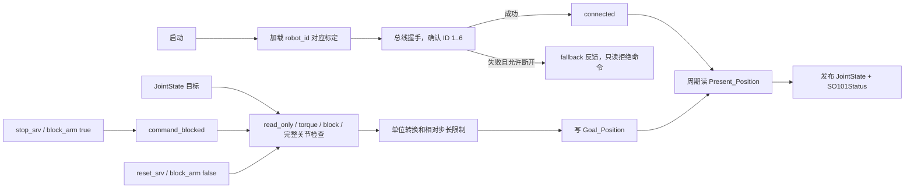

# SO101 ROS1 项目部署、控制与复现手册

## 目标

这份手册把当前仓库的实际代码、硬件接口和运行顺序整理成一份可执行资料。把它交给另一个 AI 后，它应当能够在一台连接 SO101 follower 的 Ubuntu 电脑上完成环境检查、LeRobot 配置、ROS 工作空间构建、只读验证和低风险关节控制，并能按同样的边界搭建一个类似的 ROS1 包。

本文描述的是本仓库当前源码，不把没有实现的能力写成已经存在的能力。当前项目没有视觉、逆运动学、Isaac Sim、强化学习策略或真实 MoveIt 控制器。

## 1. 总览

```mermaid
flowchart TB
    subgraph HW[真实硬件]
        USB[USB 串口 / Feetech 总线]
        MOTOR[SO101 follower<br/>6 个 STS3215 电机，ID 1..6]
        USB --- MOTOR
    end

    subgraph EXT[外部 Python 运行时]
        LR[LeRobot SOFollower<br/>标定文件 + Feetech Bus]
    end

    subgraph ROS[ROS1 Noetic]
        BRIDGE[lwh_so101_real<br/>so101_ctrl_single_node.py]
        FEEDBACK[/joint_states_single<br/>JointState，弧度]
        RELAY[topic_tools relay]
        STATE[/joint_states]
        RSP[robot_state_publisher<br/>URDF -> TF]
        GUI[PyQt 控制窗口]
        COMMAND[/joint_ctrl_single<br/>JointState，弧度]
        STATUS[/arm_status<br/>SO101Status]
        SRV[使能 / 夹爪 / 回零 / 阻塞服务]
        RVIZ[RViz RobotModel]
    end

    subgraph MODEL[机器人描述]
        URDF[lwh_so101_description/urdf/so101.urdf]
        MESH[meshes/*.stl]
        RVIZCFG[rviz/so101.rviz]
        URDF --> RSP
        MESH --> URDF
        RVIZCFG --> RVIZ
    end

    MOTOR <-->|Present_Position / Goal_Position| LR
    LR <--> BRIDGE
    BRIDGE --> FEEDBACK
    FEEDBACK --> GUI
    FEEDBACK --> RELAY --> STATE --> RSP -->|/tf| RVIZ
    GUI --> COMMAND --> BRIDGE
    BRIDGE --> STATUS
    SRV --> BRIDGE
```

主链路只有一个硬件入口：`so101_ctrl_single_node.py`。GUI、RViz 和 `robot_state_publisher` 都不能直接访问电机。电机侧使用 LeRobot/Feetech 的设备单位，ROS `JointState` 使用弧度；转换必须只发生在硬件桥接边界。

### 1.1 当前实现范围

| 能力 | 当前状态 | 入口 |
|---|---|---|
| SO101 URDF、网格、TF | 已实现 | `lwh_so101_description` |
| 读取真实 follower 位置 | 已实现 | `so101_ctrl_single_node.py` |
| 通过 ROS 发送位置目标 | 已实现，位置模式 | `/joint_ctrl_single` |
| 电机扭矩使能/失能 | 已实现 | `/enable_srv`、GUI |
| 夹爪、回零、阻塞 | 已实现 | 对应 ROS service |
| RViz 实时显示 | 已实现 | `start_so101_follower_rviz_control.launch` |
| MoveIt 假控制器规划 | 已实现 | `lwh_so101_moveit_config/demo.launch` |
| Gazebo 视觉伴随显示 | 已实现 | `lwh_so101_moveit_config/demo_gazebo.launch` |
| Gazebo 真实动力学控制 | 不是当前主链路 | `lwh_moveit_test` 中有生成模板，需单独验证 |
| 相机、抓取、IK、强化学习 | 未实现 | 需要另行增加 |

## 2. 给执行型 AI 的工作规则

执行复现时按下面顺序推进，每一步都要用命令输出或 ROS 图验证结果。没有通过前一步时，不要让真实机械臂进入可写状态。

1. 检查系统、ROS、Python、LeRobot、串口设备和标定文件。
2. 修正当前源码中的机器相关路径，再在干净构建目录中构建 catkin 工作空间。
3. 只启动模型或真实硬件的只读模式，确认 `/joint_states_single`、`/joint_states`、`/tf` 和 `/arm_status` 正常。
4. 确认 `read_only=false`、`torque_enabled=true`、`command_blocked=false` 后，才发送极小的单步位置目标。
5. 通过反馈读回确认动作方向、单位、关节名和限幅正确。
6. 最后再启动 GUI、MoveIt 或仿真；仿真和真实硬件不要在同一个 ROS master 中同时发布同名模型和状态话题。

安全边界：本项目的 `stop_srv` 只是阻止后续命令，并不会自动关闭电机扭矩；`gripper_srv` 直接写入夹爪目标，不经过身体关节的相对步长限制；代码没有硬件级急停和后台断线重连。测试时必须准备物理急停或断电方式，并让机械臂处于无碰撞、低负载姿态。

## 3. 仓库与职责

### 3.1 源码结构

```text
learn_soarm_ros/
├── src/
│   ├── lwh_so101_description/
│   │   ├── urdf/so101.urdf
│   │   ├── meshes/*.stl
│   │   └── rviz/so101.rviz
│   ├── lwh_so101_real/
│   │   ├── scripts/so101_ctrl_single_node.py
│   │   ├── scripts/so101_relative_control_gui.py
│   │   ├── launch/start_so101_follower_rviz_control.launch
│   │   ├── msg/SO101Status.msg
│   │   └── srv/{Enable,Gripper,GoZero}.srv
│   ├── lwh_so101_moveit_config/
│   │   ├── launch/{demo,demo_gazebo}.launch
│   │   ├── config/{so101.srdf,kinematics.yaml,joint_limits.yaml,...}
│   │   ├── scripts/joint_state_retimestamp.py
│   │   ├── scripts/gazebo_joint_state_sync.py
│   │   └── worlds/so101_no_gravity.world
│   └── lwh_moveit_test/
│       ├── config/                    # MoveIt Setup Assistant 生成的第二套配置
│       ├── launch/                    # 标准 MoveIt/Gazebo 模板
│       └── lwh_ros_bag/*.bag
├── guide.md                           # 已有源码说明
├── PROJECT_WALKTHROUGH.md             # 已有逐函数带读
└── SO101_REPRODUCTION_MANUAL.md       # 本手册
```

### 3.2 四个 ROS 包

| 包 | 主要文件 | 职责 | 不负责 |
|---|---|---|---|
| `lwh_so101_description` | `urdf/so101.urdf`、`meshes/`、`rviz/so101.rviz` | 定义 link、joint、轴、限位、网格和 RViz 配置 | 不读串口，不写电机 |
| `lwh_so101_real` | `so101_ctrl_single_node.py`、GUI、msg/srv | 连接 LeRobot bus，读写电机，提供 ROS 接口 | 不做 IK、路径规划或碰撞检测 |
| `lwh_so101_moveit_config` | `demo.launch`、`demo_gazebo.launch`、SRDF/YAML | 当前推荐的 MoveIt 假执行和 Gazebo 视觉同步 | 不连接真实电机 |
| `lwh_moveit_test` | 生成的 MoveIt launch/config | 另一套 Setup Assistant 模板、bag 和 ros_control 试验入口 | 不属于真机桥接主链路 |

`README.MD` 当前仍是旧 Piper 项目的说明，不能作为 SO101 部署依据。源代码、`guide.md`、`PROJECT_WALKTHROUGH.md` 和本手册才是本分支的事实来源。

## 4. 硬件、软件和依赖

### 4.1 推荐基线

| 项目 | 要求 |
|---|---|
| 操作系统 | Ubuntu 20.04 64 位；ROS1 Noetic 是当前包的目标环境 |
| ROS | `ros-noetic-desktop-full`，另需 MoveIt、Gazebo/ros-control 相关包 |
| Python | 真实桥接代码在启动时要求 Python >= 3.10；ROS Noetic 系统 Python 常为 3.8，二者要通过同一可执行解释器验证 |
| Python 包 | 与当前源码 API 兼容的 LeRobot、PyQt5；LeRobot 不是 `package.xml` 的 ROS 依赖 |
| 硬件 | SO101 follower、控制板、匹配电源、USB 数据线、6 个 STS3215 电机总线 |
| 设备节点 | 常见为 `/dev/ttyACM0` 或 `/dev/ttyUSB0`，以实际检测结果为准 |
| 标定 | `~/.cache/huggingface/lerobot/calibration/robots/so101_follower/<robot_id>.json` |

仓库没有 `requirements.txt`、`environment.yml` 或锁定的 LeRobot commit。因此不能从仓库推断唯一的 LeRobot 版本；部署时必须记录实际安装版本，并验证下面的 import/API。

### 4.2 ROS 安装

在干净的 Ubuntu 20.04 上，先按 ROS Noetic 官方安装方式配置软件源，再安装本项目用到的组件。下面是常用包集合，最终以 `rosdep` 输出为准：

```bash
sudo apt update
sudo apt install -y \
  ros-noetic-desktop-full \
  ros-noetic-moveit \
  ros-noetic-gazebo-ros-control \
  ros-noetic-ros-control \
  ros-noetic-ros-controllers \
  ros-noetic-controller-manager \
  ros-noetic-topic-tools \
  python3-pyqt5 \
  python3-rosdep \
  python3-rospkg
```

每个终端都先加载 ROS：

```bash
source /opt/ros/noetic/setup.bash
echo "$ROS_DISTRO"
command -v roscore
command -v catkin_make
```

### 4.3 LeRobot 安装与 API 验证

官方 SO-101 文档当前推荐在 LeRobot 源码目录安装 Feetech extra：

```bash
git clone https://github.com/huggingface/lerobot.git
cd lerobot
python -m pip install -e ".[feetech]"
```

本项目源码导入的类是：

```python
from lerobot.robots.so_follower.config_so_follower import SOFollowerRobotConfig
from lerobot.robots.so_follower.so_follower import SOFollower
```

在实际运行桥接节点的同一个 Python 环境中验证：

```bash
python - <<'PY'
import sys
import rospy
import PyQt5
from sensor_msgs.msg import JointState
from lerobot.robots.so_follower.config_so_follower import SOFollowerRobotConfig
from lerobot.robots.so_follower.so_follower import SOFollower

print("python:", sys.executable)
print("rospy:", rospy.__file__)
print("JointState:", JointState._type)
print("LeRobot:", SOFollower, SOFollowerRobotConfig)
PY
```

如果 `lerobot` 的新版本已经移动了 `SOFollower` 或配置类，先固定到原项目使用的 commit，或修改桥接节点的 import 和 bus 调用并重新做完整验证。不要只把 import 错误隐藏起来。

### 4.4 处理源码中的机器相关路径

`src/lwh_so101_real/scripts/so101_ctrl_single_node.py` 当前有两处作者机器路径：

```python
#!/home/a/anaconda3/envs/lerobot05/bin/python
ROS_PYTHON_PATHS = [
    "/home/a/lerobot_05/src",
    "/opt/ros/noetic/lib/python3/dist-packages",
    "/usr/lib/python3/dist-packages",
]
```

在新电脑上必须满足其一：

1. 把第一行改成实际的 Python 3.10+ 解释器路径，并把 LeRobot 安装进该环境；或
2. 改成 `#!/usr/bin/env python3`，保证 `PATH` 中的 `python3` 已经能导入 LeRobot、`rospy`、消息包和 PyQt5；同时把 `ROS_PYTHON_PATHS` 中的 LeRobot 路径改成真实路径。

修改后检查：

```bash
head -1 src/lwh_so101_real/scripts/so101_ctrl_single_node.py
python -m py_compile src/lwh_so101_real/scripts/so101_ctrl_single_node.py
python -m py_compile src/lwh_so101_real/scripts/so101_relative_control_gui.py
```

`roslaunch` 会按照脚本 shebang 启动节点，所以只在当前 shell 中 `source` 一个 Conda 环境而不修正 shebang，仍可能出现 `No such file or directory`。

## 5. SO101 电机配置和标定

以下步骤属于 LeRobot/硬件准备，不由 ROS 包替代。电机配置会写入电机非易失寄存器，必须确认电源、电压型号、线缆和电机连接正确。

### 5.1 串口和权限

先连接控制板和电源，确认设备：

```bash
ls -l /dev/ttyACM* /dev/ttyUSB* 2>/dev/null
lerobot-find-port
```

若当前用户没有串口权限：

```bash
sudo usermod -aG dialout "$USER"
```

注销并重新登录后再次检查。不要把 `sudo chmod 666` 当成长期方案。

### 5.2 一次性设置电机 ID 和波特率

官方 SO-101 follower 流程会要求逐个只连接一个电机：

```bash
export SO101_PORT=/dev/ttyACM0

lerobot-setup-motors \
  --robot.type=so101_follower \
  --robot.port="$SO101_PORT"
```

按交互提示依次连接 gripper、wrist_roll、wrist_flex、elbow_flex、shoulder_lift、shoulder_pan。完成后应得到电机 ID 6、5、4、3、2、1；再恢复完整 daisy-chain。Waveshare 控制板按官方说明把跳线置于 USB 对应通道。

如果执行时只有 USB 设备而没有电机响应，先检查电源、控制板、3-pin 线缆和电压版本；不要先修改 ROS 代码。

### 5.3 follower 标定

`robot_id` 是标定文件名的一部分，后续 ROS 启动必须复用同一个值：

```bash
export SO101_ID=my_awesome_follower_arm

lerobot-calibrate \
  --robot.type=so101_follower \
  --robot.port="$SO101_PORT" \
  --robot.id="$SO101_ID"
```

按照提示先将各关节放到中间位置，再让每个关节走完整范围。确认标定文件存在：

```bash
CALIB_DIR="$HOME/.cache/huggingface/lerobot/calibration/robots/so101_follower"
test -f "$CALIB_DIR/$SO101_ID.json" && echo "calibration exists"
ls -l "$CALIB_DIR/$SO101_ID.json"
```

驱动节点默认 `require_calibration=true`。没有标定文件时，即使串口存在，也应拒绝进入正常硬件状态。

## 6. 构建 catkin 工作空间

### 6.1 干净构建

使用当前仓库路径的全新 `build/`、`devel/`、`install/`。仓库中已有的构建缓存来自另一台机器的 `/home/a/lwh_code/soarm_ros`，其中的绝对路径不能复用。

```bash
cd /path/to/learn_soarm_ros
source /opt/ros/noetic/setup.bash
rosdep update
rosdep install --from-paths src --ignore-src --rosdistro noetic -r -y
catkin_make
source devel/setup.bash
```

如果出现类似下面的错误：

```text
CMakeCache.txt directory ... is different than .../home/a/lwh_code/soarm_ros/build
```

说明是在复用旧缓存。停止所有 ROS 节点后，把旧的生成目录移走或在全新 clone 中重新构建：

```bash
mv build build.from_old_path
mv devel devel.from_old_path
test -d install && mv install install.from_old_path
catkin_make
source devel/setup.bash
```

### 6.2 构建验收

```bash
source /opt/ros/noetic/setup.bash
source devel/setup.bash

rospack find lwh_so101_real
rospack find lwh_so101_description
rospack find lwh_so101_moveit_config
rospack find lwh_moveit_test

check_urdf src/lwh_so101_description/urdf/so101.urdf
python3 -m py_compile \
  src/lwh_so101_real/scripts/so101_ctrl_single_node.py \
  src/lwh_so101_real/scripts/so101_relative_control_gui.py \
  src/lwh_so101_moveit_config/scripts/gazebo_joint_state_sync.py \
  src/lwh_so101_moveit_config/scripts/joint_state_retimestamp.py

roslaunch --nodes lwh_so101_real start_so101_follower_rviz_control.launch
roslaunch --nodes lwh_so101_moveit_config demo.launch
roslaunch --nodes lwh_so101_moveit_config demo_gazebo.launch
```

期望 `check_urdf` 的根 link 为 `dummy_link`，并能看到 `base_link -> shoulder_link -> upper_arm_link -> lower_arm_link -> wrist_link -> gripper_link` 的树。当前源码在干净临时工作空间中已通过 catkin 构建、URDF 解析和四个包的 `rospack find` 验证；本仓库原有生成缓存仍是旧路径产物。

## 7. 机器人模型和关节契约

### 7.1 URDF 树

```text
dummy_link
└── dummy_to_base (fixed)
    └── base_link
        └── shoulder_pan
            └── shoulder_link
                └── shoulder_lift
                    └── upper_arm_link
                        └── elbow_flex
                            └── lower_arm_link
                                └── wrist_flex
                                    └── wrist_link
                                        └── wrist_roll
                                            └── gripper_link
                                                ├── gripper_frame_joint (fixed)
                                                └── gripper
                                                    └── moving_jaw_so101_v1_link
```

`dummy_link` 用于稳定根坐标和 RViz/KDL；RViz 的 Fixed Frame 是 `dummy_link`。`gripper_frame_link` 是固定的工具参考坐标，MoveIt 的 arm group 末端是 `gripper_link`。

### 7.2 电机、ROS 关节和范围

| 顺序 | 电机 ID | ROS joint | 设备侧输入输出 | ROS `JointState.position` | URDF lower..upper |
|---:|---:|---|---|---|---|
| 1 | 1 | `shoulder_pan` | 度 | 弧度 | `-1.91986 .. 1.91986` |
| 2 | 2 | `shoulder_lift` | 度 | 弧度 | `-1.74533 .. 1.74533` |
| 3 | 3 | `elbow_flex` | 度 | 弧度 | `-1.69 .. 1.69` |
| 4 | 4 | `wrist_flex` | 度 | 弧度 | `-1.65806 .. 1.65806` |
| 5 | 5 | `wrist_roll` | 度 | 弧度 | `-2.74385 .. 2.84121` |
| 6 | 6 | `gripper` | 百分比 `0..100` | 弧度 | `-0.174533 .. 1.74533` |

代码中的固定顺序必须保持一致：

```python
JOINT_NAMES = [
    "shoulder_pan", "shoulder_lift", "elbow_flex",
    "wrist_flex", "wrist_roll", "gripper",
]
```

如果 `JointState.name` 非空，驱动要求六个名字全部出现，并按名字重排；如果 `name` 为空，驱动按上表的六项顺序解释 `position`。新节点应始终填写 `name`，避免数组顺序错误。

## 8. 真实硬件桥接节点

核心文件：`src/lwh_so101_real/scripts/so101_ctrl_single_node.py`。

### 8.1 启动阶段

节点构造时依次完成：

1. 读取私有 ROS 参数。
2. 注册 publisher、subscriber 和 service。
3. 创建 `SOFollowerRobotConfig`，设置 `port`、`id`、`use_degrees=True` 和 `calibration_dir`。
4. 检查 `bus.calibration`。
5. `bus.connect(handshake=True)`，确认电机总线。
6. 连接失败时，如果 `allow_disconnected=true`，保留节点并发布 fallback 零位；如果为 `false`，节点直接退出。

自动串口扫描只在握手错误包含 `motor check failed` 且 `auto_port=true` 时触发，并要求扫描到完整电机 ID 集合 `{1,2,3,4,5,6}`。当前 launch 的 `auto_port` 默认是 `false`，所以建议部署时显式传 `auto_port:=true` 或直接传已确认的 `port`。

### 8.2 运行阶段

默认发布频率为 50 Hz。每轮循环：

```text
bus.sync_read("Present_Position")
        ↓
按 JOINT_NAMES 组装字典
        ↓
身体关节：度 -> 弧度
夹爪：百分比 -> [-0.174533, 1.74533] 弧度
        ↓
/joint_states_single (sensor_msgs/JointState)
```

读取异常只记录 `read failed: ...`，下一轮继续尝试；当前代码没有构造阶段之后的后台重连线程。

### 8.3 写入阶段

收到 `/joint_ctrl_single` 后，驱动按下列顺序拒绝危险命令：

```text
read_only=true       -> 拒绝
未连接               -> 拒绝
torque 未使能        -> 拒绝
command_blocked=true -> 拒绝
消息缺少关节         -> 拒绝
```

通过检查后：

1. ROS 身体关节弧度转设备度，夹爪弧度转百分比。
2. 读取最近一次设备反馈作为 current。
3. 身体关节的单次目标变化限制在 `±max_relative_target_deg`，launch 默认 10 度。
4. 夹爪的单次目标变化限制在 `±max_relative_target_gripper`，launch 默认 15 个百分点。
5. 调用 `bus.sync_write("Goal_Position", safe_target)`。

这只是单次目标增量限制，不是速度控制、碰撞检测、硬件急停或轨迹执行器。

## 9. ROS 接口数据契约

### 9.1 Topic

| 名称 | 类型 | 方向 | 约定 |
|---|---|---|---|
| `/joint_states_single` | `sensor_msgs/JointState` | 驱动 -> GUI/relay | 六个 joint；position 全是弧度；50 Hz 默认 |
| `/joint_states` | `sensor_msgs/JointState` | relay -> RSP/其他 ROS 节点 | `/joint_states_single` 原样转发 |
| `/joint_ctrl_single` | `sensor_msgs/JointState` | GUI/外部控制器 -> 驱动 | 目标 position 弧度；推荐填写六个 `name` |
| `/enable_flag` | `std_msgs/Bool` | 外部 -> 驱动 | `true`/`false` 直接请求扭矩状态 |
| `/arm_status` | `lwh_so101_real/SO101Status` | 驱动 -> 诊断 | latch；连接、扭矩、只读、阻塞、串口和文本 |

### 9.2 Service

| 名称 | 类型 | 请求 | 行为 |
|---|---|---|---|
| `/enable_srv` | `lwh_so101_real/Enable` | `enable_request: bool` | 改变全部电机 torque；`read_only=true` 时拒绝 |
| `/gripper_srv` | `lwh_so101_real/Gripper` | `gripper_position: float64`，百分比 | 限制到 `0..100` 后写 `Goal_Position`；不走身体关节相对步长函数 |
| `/go_zero_srv` | `lwh_so101_real/GoZero` | `confirm: true` | 目标全为设备侧零值，但仍经过相对步长限制 |
| `/stop_srv` | `std_srvs/Trigger` | 空 | 设置 `command_blocked=true`；不关闭 torque |
| `/reset_srv` | `std_srvs/Trigger` | 空 | 清除命令阻塞 |
| `/block_arm` | `std_srvs/SetBool` | `data: true/false` | 设置或清除命令阻塞 |

消息定义：

```text
# SO101Status.msg
std_msgs/Header header
bool connected
bool torque_enabled
bool read_only
bool command_blocked
string port
string message
```

## 10. 启动真实 SO101

### 10.1 只读首验

真机 launch 的参数由 `src/lwh_so101_real/launch/start_so101_follower_rviz_control.launch` 传给节点。注意 launch 值会覆盖 Python 内的默认值：

| 参数 | 当前 launch 默认值 | 说明 |
|---|---:|---|
| `port` | `/dev/ttyACM0` | 以 `lerobot-find-port` 实际结果为准 |
| `robot_id` | `my_awesome_follower_arm` | 必须与标定 JSON 文件名一致 |
| `calibration_dir` | `/home/a/.cache/huggingface/lerobot/calibration/robots/so101_follower` | 旧机器绝对路径，部署时必须显式覆盖或修改 launch |
| `read_only` | `false` | 首次测试必须显式传 `true` |
| `auto_enable` | `false` | 不自动开 torque |
| `auto_port` | `false` | 默认不扫描其他串口，建议确认后显式传 `true` |
| `allow_disconnected` | `true` | 失败时会用 fallback 继续运行；硬件验收建议传 `false` |
| `publish_rate` | `50.0` | 反馈发布频率，Hz |
| `max_relative_target_deg` | `10.0` | 五个身体关节的单次目标步长，度 |
| `max_relative_target_gripper` | `15.0` | 夹爪的单次目标步长，百分比 |
| `disable_torque_on_shutdown` | `false` | 建议测试时显式传 `true`，但退出前仍应检查 torque 状态 |

节点内部还有 `require_calibration=true` 和 `start_blocked=false` 两个参数，当前 launch 没有暴露成 arg；需要改变时只能给节点增加 `<param>` 或修改代码。

先开一个终端：

```bash
source /opt/ros/noetic/setup.bash
roscore
```

另开终端，使用已确认的端口、ID 和标定目录：

```bash
cd /path/to/learn_soarm_ros
source /opt/ros/noetic/setup.bash
source devel/setup.bash

roslaunch lwh_so101_real start_so101_follower_rviz_control.launch \
  port:=/dev/ttyACM0 \
  robot_id:=my_awesome_follower_arm \
  calibration_dir:="$HOME/.cache/huggingface/lerobot/calibration/robots/so101_follower" \
  read_only:=true \
  auto_enable:=false \
  auto_port:=true \
  allow_disconnected:=false \
  disable_torque_on_shutdown:=true
```

只读模式应能读取位置并显示 RViz，但 `/enable_srv` 和 `/joint_ctrl_single` 都会被拒绝。先执行检查：

```bash
rosnode list
rostopic type /joint_states_single
rostopic hz /joint_states_single
rostopic echo -n 1 /joint_states_single
rostopic echo -n 1 /joint_states
rostopic echo -n 1 /arm_status
rosservice list | grep -E 'enable_srv|gripper_srv|go_zero_srv|stop_srv|reset_srv|block_arm'
```

验收条件：

- `arm_status.connected: true`。
- `arm_status.read_only: true`。
- `/joint_states_single` 的六个名字和位置数组长度一致。
- 手动轻微移动机械臂或关节后，反馈数值改变，RViz 模型跟随。
- `/tf` 中存在 `dummy_link` 到各 link 的变换。

### 10.2 进入可写模式

确认机械臂处于安全姿态、人员远离运动范围后，停止只读 launch，再启动：

```bash
roslaunch lwh_so101_real start_so101_follower_rviz_control.launch \
  port:=/dev/ttyACM0 \
  robot_id:=my_awesome_follower_arm \
  calibration_dir:="$HOME/.cache/huggingface/lerobot/calibration/robots/so101_follower" \
  read_only:=false \
  auto_enable:=false \
  auto_port:=true \
  allow_disconnected:=false \
  disable_torque_on_shutdown:=true
```

通过服务使能，检查返回值和状态：

```bash
rosservice call /enable_srv "enable_request: true"
rostopic echo -n 1 /arm_status
```

GUI 的“使能”按钮做同一件事；GUI 首次收到反馈时会把滑块同步到真实当前位置，避免默认滑块值突然成为目标。首次运动建议只移动一个身体关节几度，并观察反馈方向。

外部控制节点或命令行必须发布 `sensor_msgs/JointState`。消息的 `name` 和 `position` 示例（仅展示格式；把其余五项替换为当前反馈，确认安全后再发送）：

```bash
rostopic pub -1 /joint_ctrl_single sensor_msgs/JointState \
  '{name: [shoulder_pan, shoulder_lift, elbow_flex, wrist_flex, wrist_roll, gripper],
    position: [0.01745, 0.0, 0.0, 0.0, 0.0, 0.0]}'
```

上例把 `shoulder_pan` 目标写成约 1 度，ROS 单位是弧度；驱动仍会以最近一次设备反馈为基准执行相对步长限制。不要在不知道当前姿态的情况下把五个关节都填零后直接发送。

停止命令流：

```bash
rosservice call /stop_srv "{}"
rostopic echo -n 1 /arm_status
```

恢复命令接收：

```bash
rosservice call /reset_srv "{}"
# 或
rosservice call /block_arm "data: false"
```

退出节点前，如需明确关闭扭矩，应调用：

```bash
rosservice call /enable_srv "enable_request: false"
```

## 11. 从零搭建一个类似 ROS 包

下面是把本项目抽象成可复用工程时的搭建顺序。

### 11.1 创建工作空间

```bash
mkdir -p ~/so101_ws/src
cd ~/so101_ws
source /opt/ros/noetic/setup.bash
catkin_make
source devel/setup.bash
```

### 11.2 机器人描述包

创建 `so101_description`，至少包含：

```text
package.xml
CMakeLists.txt
urdf/so101.urdf
meshes/*.stl
rviz/so101.rviz
```

URDF 要提供：

- 一个根 link；本项目用空的 `dummy_link` 再接 `base_link`。
- 六个可动 joint 的稳定名称、父子 link、axis 和 limit。
- 每个 link 的 visual；若做 Gazebo 动力学，再提供 collision、inertial 和 transmission。
- 所有 mesh 使用 `package://so101_description/...`，不要写开发机绝对路径。
- RViz Fixed Frame 和 URDF 根 frame 保持一致。

先只启动 `robot_state_publisher` 和静态 `JointState`，确认模型树和 TF，再接硬件。

### 11.3 真机桥接包

创建 `so101_real`，`package.xml`/`CMakeLists.txt` 至少声明：

```text
message_generation / message_runtime
rospy
sensor_msgs
std_msgs
std_srvs
so101_description
robot_state_publisher
topic_tools
rviz
python3-pyqt5
```

LeRobot 是 Python 外部依赖，必须在部署文档和启动前检查中单独处理；不能只依赖 `rosdep`。

CMake 核心结构：

```cmake
find_package(catkin REQUIRED COMPONENTS
  message_generation rospy sensor_msgs std_msgs std_srvs)

add_message_files(FILES SO101Status.msg)
add_service_files(FILES Enable.srv Gripper.srv GoZero.srv)
generate_messages(DEPENDENCIES std_msgs)

catkin_package(CATKIN_DEPENDS message_runtime rospy sensor_msgs std_msgs std_srvs)

install(PROGRAMS
  scripts/so101_ctrl_single_node.py
  scripts/so101_relative_control_gui.py
  DESTINATION ${CATKIN_PACKAGE_BIN_DESTINATION})
```

### 11.4 桥接节点的最小职责

桥接节点不应把 UI、规划和硬件协议混在一起。最小状态机如下：



建议把以下函数保持为独立边界：

```text
connect_bus()
read_positions()
publish_joint_state()
extract_joint_targets()
ros_to_device_units()
limit_relative_target()
write_joint_targets()
set_torque()
publish_status()
```

这样以后接入策略、MoveIt 或 teleoperation 时，只新增 ROS 控制器节点，不直接复制一份串口写入代码。

### 11.5 启动文件

本项目的真机 launch 做了五件事：

1. 把 URDF 放到 `robot_description`。
2. 启动硬件桥。
3. 启动 `robot_state_publisher`。
4. relay `/joint_states_single` 到 `/joint_states`。
5. 启动 RViz 和 PyQt GUI。

新项目应把端口、ID、标定目录、`read_only`、`auto_enable`、`allow_disconnected` 和限幅都暴露为 launch arg，不要把它们埋在 Python 默认值中。

## 12. MoveIt、Gazebo 和 bag

### 12.1 推荐的 MoveIt 假执行入口

```bash
source /opt/ros/noetic/setup.bash
source devel/setup.bash
roslaunch lwh_so101_moveit_config demo.launch
```

这个入口：

- 加载 `lwh_so101_description/urdf/so101.urdf` 和 `so101.srdf`。
- 使用 KDL 运动学和 OMPL。
- 使用 `moveit_fake_controller_manager`，不是实际电机控制器。
- 将 fake controller 的关节状态重新打时间戳后交给 `robot_state_publisher`。
- 可在 RViz MotionPlanning 中进行规划和 fake 执行。

它不会连接串口，也不会驱动真实机械臂。

### 12.2 Gazebo 视觉伴随入口

```bash
roslaunch lwh_so101_moveit_config demo_gazebo.launch
```

该入口使用无重力 world，`gazebo_joint_state_sync.py` 读取 URDF visual 并为各 link 生成独立的运动学视觉模型，再根据 TF 更新 Gazebo 位姿。它的目的是真实显示外观和验证 MoveIt 状态链，不是稳定的 `ros_control` 动力学仿真。

### 12.3 `lwh_moveit_test` 的边界

`lwh_moveit_test` 是 MoveIt Setup Assistant 生成的第二套配置，包含标准 fake controller、`gazebo_so101.urdf`、ros_control YAML 和 bag。它可用于研究标准 MoveIt 文件如何组织，但其 `package.xml` 中 Gazebo/ros-control 依赖仍有注释，不能默认认为 `demo_gazebo.launch` 在全新机器上可直接工作。复现主项目时优先使用 `lwh_so101_moveit_config`。

### 12.4 不要混用 ROS master

真机入口、`lwh_so101_moveit_config/demo.launch` 和 Gazebo 入口都会使用 `robot_description`、`/joint_states` 和 `/tf`。不要在同一个 ROS master 同时启动它们，否则会出现模型覆盖、重复 TF 或状态源竞争。需要并行测试时使用不同 master，例如：

```bash
# 终端 A
ROS_MASTER_URI=http://localhost:11311 roslaunch ...

# 终端 B，使用另一个 master 和端口
ROS_MASTER_URI=http://localhost:11312 roscore
```

### 12.5 录制真实反馈

仓库没有自动的真实数据录制入口，可用 ROS 原生 bag：

```bash
rosbag record -O so101_real_check.bag \
  /joint_states_single \
  /joint_states \
  /joint_ctrl_single \
  /arm_status
```

回放前先确认没有真实写入节点订阅命令话题：

```bash
rosbag info so101_real_check.bag
rosbag play --clock so101_real_check.bag
```

## 13. 故障排查

| 现象 | 先检查 | 处理 |
|---|---|---|
| `catkin_make` 提示 CMakeCache 来自 `/home/a/...` | `build/CMakeCache.txt`、`devel` | 使用全新生成目录或移走旧 `build/devel/install` |
| `roslaunch` 找不到包 | `echo $ROS_PACKAGE_PATH`、`rospack find` | 先 `source /opt/ros/noetic/setup.bash`，再 `source devel/setup.bash` |
| 节点报 shebang 路径不存在 | `head -1 so101_ctrl_single_node.py` | 改为当前 Python 3.10+ 解释器，且让该解释器能导入 ROS/LeRobot |
| `No module named lerobot` | 在启动解释器中运行 import 检查 | 在同一环境安装 LeRobot，或修正 `ROS_PYTHON_PATHS` |
| `No SO101 calibration file` | 标定目录、`robot_id`、文件名 | 重新标定；启动参数中的 ID 必须与文件名相同 |
| 串口能看到但 motor check 失败 | 电源、3-pin 线、控制板跳线、ID 1..6 | 先执行 LeRobot motor setup；需要扫描时传 `auto_port:=true` |
| `Permission denied: /dev/ttyACM0` | `groups`、`ls -l` | 加入 `dialout` 并重新登录 |
| `connected=false` 但 RViz 能开 | `/arm_status` | 这是 `allow_disconnected=true` 的 fallback 行为；它不代表硬件已连接 |
| 点击使能没有动作 | `read_only`、连接状态 | `read_only=true` 或总线未连接会拒绝 torque |
| 发命令没有动作 | `torque_enabled`、`command_blocked` | 先 `/enable_srv true`，必要时 `/reset_srv`；检查消息是否含六个 joint |
| stop 后电机仍保持扭矩 | `/arm_status` | 这是设计行为；另调用 `/enable_srv false` 或执行物理急停 |
| RViz 空白/模型不动 | `robot_description`、`/joint_states`、`/tf`、Fixed Frame | 确认 relay、joint 名和 `dummy_link` frame |
| MoveIt 能规划但真机不动 | controller manager | 当前 MoveIt 是 fake execution，未连接真机桥 |
| Gazebo 模型抖动或无动力学 | 使用的 launch | `lwh_so101_moveit_config/demo_gazebo` 是视觉伴随，不是完整动力学控制 |
| GUI 无反馈 | `rostopic echo /joint_states_single` | 先修复桥接节点；GUI 不直接读串口 |

## 14. 验收清单

### 环境

- [ ] `rosversion -d` 输出 `noetic`。
- [ ] `command -v catkin_make`、`roslaunch`、`rospack` 均可用。
- [ ] 启动脚本的 Python 解释器为 3.10+，能导入 `rospy`、`sensor_msgs`、`PyQt5` 和当前 LeRobot API。
- [ ] `rosdep install --from-paths src --ignore-src -r -y` 无未满足 ROS 依赖。

### 构建和模型

- [ ] `catkin_make` 在当前路径的干净缓存中完成。
- [ ] 四个包都能通过 `rospack find` 找到。
- [ ] `check_urdf` 成功，根 link 为 `dummy_link`。
- [ ] `roslaunch --nodes` 能解析真机和 MoveIt 入口。

### 硬件

- [ ] `lerobot-find-port` 找到 follower 控制板。
- [ ] 电机 ID 为 1 到 6，电源和总线线缆无异常。
- [ ] 标定 JSON 存在，且文件名与 `robot_id` 完全一致。
- [ ] 只读 launch 中 `/arm_status.connected=true`。
- [ ] `/joint_states_single` 的名字、顺序、单位和频率正确。
- [ ] RViz 的模型随真实反馈变化。

### 可写控制

- [ ] `read_only=false` 之前已经通过只读验收。
- [ ] 只有明确调用 `/enable_srv true` 后才有 torque。
- [ ] 第一个命令是小幅、单关节、无碰撞目标。
- [ ] 反馈方向和目标方向一致。
- [ ] `/stop_srv`、`/reset_srv`、`/enable_srv false` 都已实测。
- [ ] 有物理急停或断电方案。

## 15. 已知缺口与交付给下一个 AI 的信息

要做到“换一台电脑后一次复现”，还需要在交接时补充这些机器相关信息：

1. 实际 LeRobot 仓库 commit 或版本号。
2. 使用的 Python 环境路径和 `python -c 'import lerobot; print(...)'` 输出。
3. follower 控制板实际串口。
4. `robot_id` 和对应 calibration JSON 是否已安全交付。
5. 电机/控制板电压型号、供电方式和是否使用 Waveshare 板。
6. 是否只需要真实控制，还是还要 MoveIt/Gazebo、相机或策略节点。
7. 真机测试时确认的最大安全速度、工作空间和急停方式。

当前仓库本身不能证明真实硬件已经在当前电脑上成功连接：源码分析和干净 catkin/URDF/launch 静态验证已经完成，但 LeRobot 硬件握手、标定和真实运动必须在接上 SO101 后由执行者完成。

## 16. 可直接交给另一个 AI 的执行提示词

```text
你是一个负责复现 SO101 follower ROS1 项目的机器人软件工程师。

目标：在 Ubuntu 20.04 + ROS Noetic 上，把当前仓库构建起来，接入 SO101 follower，先完成只读反馈和 RViz 显示，再完成带安全门的低幅位置控制。不要把 MoveIt fake controller 或 Gazebo 视觉同步当成真实电机控制。

执行顺序：
1. 检查 ROS Noetic、catkin_make、Python >= 3.10、PyQt5、LeRobot import，以及 /dev/ttyACM* 或 /dev/ttyUSB*。
2. 修正 so101_ctrl_single_node.py 的硬编码 shebang 和 LeRobot 路径；记录 LeRobot 版本。
3. 使用官方 LeRobot SO-101 流程完成 find-port、setup-motors、calibrate。确认 calibration_dir/robot_id.json 存在。
4. 在全新的 build/devel/install 中执行 catkin_make 和 rosdep install；不要复用来自其他绝对路径的 CMakeCache。
5. 执行 check_urdf、rospack find 和 roslaunch --nodes 静态验证。
6. 启动 start_so101_follower_rviz_control.launch，参数先设置 read_only:=true、auto_enable:=false、allow_disconnected:=false，并确认 /arm_status.connected、/joint_states_single、/joint_states、/tf、RViz 都正常。
7. 只在硬件和人员安全时启动 read_only:=false；调用 /enable_srv true；发送一个小幅单关节 JointState；确认反馈方向正确。
8. 出现异常先查看 /arm_status、rosnode list、rostopic hz/echo、rosservice list，再检查电源、线缆、ID、标定、权限和 Python 解释器。
9. 仿真使用 lwh_so101_moveit_config/demo.launch 或 demo_gazebo.launch；它们不连接真实电机。不要和真机入口在同一 ROS master 同时启动。

必须遵守的数据契约：
- joint 顺序：shoulder_pan, shoulder_lift, elbow_flex, wrist_flex, wrist_roll, gripper。
- ROS JointState.position 全部使用弧度；LeRobot 身体关节使用度；夹爪设备侧使用 0..100 百分比。
- /joint_ctrl_single 必须提供六个 joint 名和目标位置。
- 身体关节单次目标默认最多变化 10 度，夹爪最多变化 15%。
- stop_srv 只阻塞命令，不等于关闭 torque；明确关闭 torque 要调用 /enable_srv false 或物理急停。

最终报告必须包含：执行过的命令、关键输出、实际串口、robot_id、LeRobot 版本、ROS 话题/服务检查结果、是否通过只读验收、是否通过低幅运动验收，以及尚未验证的项目。
```

## 17. 参考文件和外部资料

- 真机入口：`src/lwh_so101_real/launch/start_so101_follower_rviz_control.launch`
- 硬件桥：`src/lwh_so101_real/scripts/so101_ctrl_single_node.py`
- GUI：`src/lwh_so101_real/scripts/so101_relative_control_gui.py`
- 模型：`src/lwh_so101_description/urdf/so101.urdf`
- RViz：`src/lwh_so101_description/rviz/so101.rviz`
- MoveIt/Gazebo 推荐入口：`src/lwh_so101_moveit_config/launch/`
- 生成的 MoveIt 模板：`src/lwh_moveit_test/launch/`
- 现有源码带读：`PROJECT_WALKTHROUGH.md`
- 现有简要说明：`guide.md`
- LeRobot 官方 SO-101 配置、设置电机和标定：[huggingface.co/docs/lerobot/en/so101](https://huggingface.co/docs/lerobot/en/so101)
- LeRobot 官方真实机器人流程（teleoperate、record、replay、train）：[github.com/huggingface/lerobot/blob/main/docs/source/il_robots.mdx](https://github.com/huggingface/lerobot/blob/main/docs/source/il_robots.mdx)
